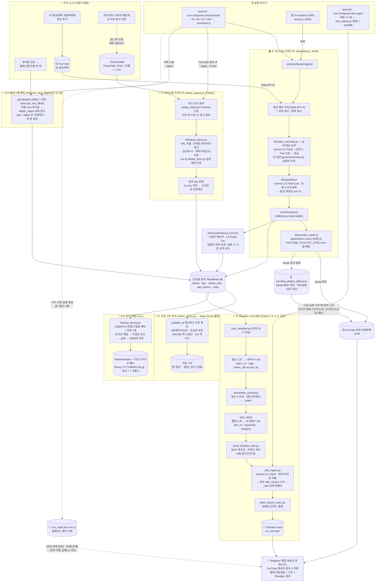

# 🎬 YouTube + 📎 카카오톡·텔레그램 → 로컬 장부 → Obsidian LLM Wiki (+ 구글 시트 미러)

**현재 버전: v4.20.0** (2026-11-09)

YouTube 재생목록의 영상을 **Gemini AI**가 실제 영상을 보고 요약·분류하고, 카카오톡 '나와의 채팅'과 텔레그램 전용 봇 방에 공유해 둔 **AI 자료 링크**를 자동 수집하여
맥 안의 **로컬 장부**(SQLite 파일 `data/library.db`)에 적재한 뒤, **Obsidian**으로 동기화해 하나의 **LLM Wiki** 지식베이스로 합성하는 자동화 파이프라인입니다.
장부 내용은 **구글 시트**에 보기용 사본(미러)으로 자동 복사됩니다.

> 2026-10-12: 저장소·폴더 이름을 `AI_Wiki_Pipeline` 으로 바꿨습니다(옛 이름 `YouTube_Notion_Grab` — 옛 주소는 GitHub 이 새 주소로 넘겨 줍니다).
> v3.0부터 지식 소스는 **YouTube 영상 + AI 자료 링크(꿀팁)** 두 갈래이고(꿀팁 입구는 카카오톡 CSV · v4.18 텔레그램 전용 봇), 장부 이후 단계(Obsidian 노트 → Wiki 합성 → MOC)는 두 소스가 공유합니다.

---

## ⚡ Vibe Coding with AI

* **Agentic Tool**: Claude Code (Claude Desktop Code 탭) — 실행 PM `pm-wiki` + 워커 서브에이전트(implementer · verifier · investigator · scribe, `.claude/agents/`) · 훅 게이트(`.claude/hooks/`) · Cowork(claude.ai 프로젝트 — 정시 실행 관찰·상담)
* **사용 AI 모델**: Claude Opus(PM · 검수 · 조사) · Claude Sonnet(구현) · Claude Haiku(문서 기록) — 파이프라인이 런타임에 쓰는 Gemini 모델은 「🛠️ 기술 스택」
* **Coding Style**: **Vibe Coding** — 작업지시서(`docs/tasks/`) → 구현 → 기준표 검수 → 회귀 테스트 20종 → push. 보안·계정 보호 1순위, dry-run 기본, 실패 시 멈춤(fail-closed)

---

## ✨ 핵심 기능 (Key Features)

- 🎥 **YouTube 재생목록 자동 수집** — YouTube Data API v3로 재생목록 영상 전체 조회
- 🤖 **Gemini AI 자동 요약 (v4.6)** — 공개 영상은 실제 영상(YouTube URL)을 Gemini 에 넣어 4섹션 요약 + 사실 신호를 받고, 안 되면 제목·설명란으로 요약
- 🗄️ **로컬 장부 저장 (v4.0)** — 요약 결과를 맥의 SQLite 파일 `data/library.db` 에 저장 (외부 서비스 의존 없음)
- 🔄 **스마트 중복 방지** — 장부 전량을 캐시로 읽어 메모리에서 즉시 중복 체크 ("전부 읽었거나, 던지거나")
- 📊 **통계 자동 업데이트** — (레거시 `--legacy` 모드) 이미 있는 영상의 조회수·구독자수가 15% 이상 변하면 갱신. 기본 마스터 모드는 중복 영상을 건너뛰기만 한다
- 📎 **카카오톡 링크 자동 수집 (v3.0)** — '나와의 채팅' 내보내기 CSV에서 AI 자료 링크를 추출·정규화해 장부 `tips` 에 신규만 적재 (장부 대조 기반 멱등성)
- 📮 **텔레그램 꿀팁 입구 (v4.18)** — 휴대폰 공유 → 전용 봇 방 → 정시 실행마다 `telegram_tips_ingest.py` 가 카톡과 같은 엔진으로 장부 `tips` 에 넣고 봇 방에 답장
- 🏷️ **원문 제목 조회·분류 (v4.8~v4.19)** — 꿀팁 링크의 원문 제목을 가져오고(노션 공개 페이지·유튜브·og:title), 카테고리·태그는 규칙 한 곳(`lib/kakao_parse.classify`)에서
- 🎚 **품질 등급 (v4.6)** — 판매가 주목적·일반론·AI 무관(토픽 분류도 비었을 때) 영상은 `grade: exclude` 로 Wiki 합성·검색에서만 뺌(노트는 남김)
- 🔁 **기존분 재요약 (v4.6-b)** — 설명란으로 만든 옛 요약을 정시 실행마다 실제 영상으로 천천히 다시 요약(Gemini 3.5 Flash-Lite, 실패하면 기존 요약 유지)
- 📓 **Obsidian 자동 동기화** — 장부의 영상·꿀팁 신규 항목을 Obsidian 노트로 생성, LLM Wiki 자동 합성
- 📗 **구글 시트 미러 (v4.0)** — 장부의 영상·꿀팁을 구글 시트 두 탭에 보기용으로 복사 (매 실행 끝에 변경분만)
- 🛟 **장부 자동 백업 (v4.1)** — 하루 1회 장부 스냅샷(무결성 검사 + gzip)을 로컬 `data/backups/` 와 구글 드라이브 폴더에 저장, 최신 7개 + 주별 4개 보관
- 🔗 **Wiki 링크 자동 구성** — 재생목록별 MOC, 채널별 목차, 키워드 링크 자동 생성 (내용이 같으면 파일을 다시 쓰지 않음)
- 🔎 **Wiki 검색 (v3.2)** — 이 맥·집 안 다른 컴퓨터·Claude(MCP)에서 의미 검색 + AI 답변
- 📱 **텔레그램 알림** — 장부 저장·재요약·카톡·텔레그램 꿀팁·시트·Obsidian 결과 통합 전송
- 🚨 **실행 실패 알림 (v4.2)** — 영상을 하나도 확인하지 못한 실행·치명적 오류는 바로, 네트워크가 죽어 못 보낸 알림·도중에 멈춘 실행·빠진 정시 실행은 다음 실행이 알림 (`.run_state.json`)
- 🧭 **매일 Wiki 검토 (v4.20)** — 매일 08:30 새로 들어온 영상·꿀팁을 Claude 가 읽고 스킬/적용 제안 0~3건 → 텔레그램 알림 → 제안함 화면에서 승인(스킬 설치)·보류·거절
- ⏰ **launchd 자동 스케줄링** — 웹 서버·집 안 검색 서버 상주, 스케줄러 00/06/12/18시 · Wiki 인제스트 17:30 (둘 다 `caffeinate -i` 로 감싸 실행 중 유휴 잠자기 방지)

---

## 🏗️ 아키텍처·데이터 파이프라인 (v4.19)

### 전체 데이터 흐름



### 한 사이클(6시간)에서 실제로 일어나는 일

| 순서 | 단계 | 실행 주체 | 입력 | 출력 | 아무 것도 없을 때 |
|:--:|---|---|---|---|---|
| 0 | 직전 실행 점검 (v4.2) | `scheduler.js` | `.run_state.json` | 못 보낸 실패·끝나지 못한 실행·9시간 넘는 간격이면 `[직전 실행 점검]` 텔레그램 | 첫 실행·정상이면 생략 |
| 1 | 대기 큐 소진 | `scheduler.js:flushPendingQueue()` | `pending_playlist_adds.json` | 재생목록 추가 (quota 한도 내) | 큐 비어 있으면 생략. `YOUTUBE_PLAYLIST_SYNC=false` 면 건너뜀 |
| 2 | YouTube 마스터 인제스트 | `scheduler.js` | 'AI 영상목록' 신규 영상 | 요약(`lib/video_summary.js` 실제 영상 → 안 되면 `geminiSummarize` 설명란) → 토픽 분류(`lib/classifier.js`) → 등급 재판정 → 장부 `videos` 행 → 토픽 재생목록 추가(`YOUTUBE_PLAYLIST_SYNC=true` 일 때만) | 장부 캐시 대조 후 0건 처리 |
| 2a | 기존분 재요약 (v4.6-b) | `scheduler.js:runResummary()` → `lib/resummarize.js` | 장부 `summary_src != 'video'` 영상(최신 업로드부터) | 요약·등급 교체 + 그 소스 `wiki_extract` stale | 실행당·하루(PT) 상한이 차거나 대상 0이면 생략. 5xx·분량 상한이면 그 실행 재요약 중단(기존 요약 유지) |
| 2b | 실행 결과 기록 (v4.2) | `scheduler.js` | 1·2 결과 | `.run_state.json` · 저장 0 · Skip 0 · 오류 ≥1 이면 `[실행 실패]` 텔레그램 | 정상이면 기록만 |
| 3 | 카톡 인제스트 | `kakao_ingest.py --apply --if-new` | `~/Downloads` 최신 CSV | 장부 `tips` 신규 행 | 같은 CSV(mtime)면 장부 조회 없이 즉시 종료 |
| 3b | 텔레그램 꿀팁 (v4.18) | `telegram_tips_ingest.py --apply` | 전용 봇 `getUpdates`(장부 `meta.tips_bot_offset` 이후) | 장부 `tips` 신규 행 + 봇 방 답장 | `.env TIPS_BOT_TOKEN` 이 없으면 건너뜀. 입구가 막히거나 18시간 동안 수신이 없으면 알림 봇이 따로 알림 |
| 4 | 시트 미러 (v4.0) | `sheet_mirror.py` | 장부 중 `updated_at` > 워터마크 | 시트 '영상'·'꿀팁' 탭 덮어쓰기/추가 | 바뀐 행 0이면 요청 0. `.env` 미설정이면 건너뜀 |
| 4b | 장부 백업 (v4.1) | `backup_library.py` | 장부 전체 (읽기 전용) | `data/backups/`·드라이브 폴더의 `library-YYYYMMDD.db.gz` | 오늘(KST) 파일이 있으면 건너뜀 → 실제로는 하루 1회. 실패는 텔레그램 별도 알림 |
| 5 | 영상 노트 동기화 | `sync_obsidian.py` | 장부 `videos` | `VAULT/<토픽>/*.md` (v4.6-b 재요약 노트는 요약 절만 제자리 교체) | 0건 |
| 6 | 고아 격리 | `sync_obsidian.py:quarantine_orphans()` | Vault 영상 노트 vs 장부 | `_trash/<ts>/` 이동 | 3중 안전장치 하나라도 걸리면 아무것도 안 함 |
| 7 | 꿀팁 노트 동기화 | `sync_obsidian.py:sync_tips()` | 장부 `tips` | `VAULT/AI 꿀팁/*.md` | 0건 |
| 8 | MOC·키워드 재구성 | `build_obsidian_wiki.py` | Vault 전체 | `_MOC/*.md`, 노트 하단 관련 항목 | 내용이 같으면 파일을 쓰지 않음 (v4.0) |
| 9 | Wiki 합성 | `wiki_ingest.py --no-backfill` | 미처리 노트 | 장부 `wiki_extract` 누적 → `_wiki/entities`·`concepts`·`index.md` 재렌더 | 신규 노트 없으면 생략 (backfill 은 17:30 launchd 실행만) |
| 9b | 검색 인덱스 | `build_search_index.py` | 바뀐 노트 | `wiki_index.json`·`.vec` 증분 | 변경 0이면 생략 |
| 10 | 알림 | `scheduler.js` | 2·2a·3·3b·4·5~9 결과 | Telegram 1개 메시지 | 변경 0이면 발송 생략 (시트 실패는 알림 · 백업 실패는 별도 알림 · 실패 알림은 0·2b) |

## 🏛️ 모듈별 상세 구조

### 두 소스의 격리 원칙

영상 노트와 꿀팁 노트는 **같은 Vault, 다른 폴더, 다른 프론트매터 키**를 쓴다. 이 구분이 고아 격리 안전장치를 지킨다.

| | 영상 노트 | 꿀팁 노트 (v3.0 카톡 · v4.18 텔레그램) |
|---|---|---|
| 폴더 | `<토픽명>/` (33개) | `AI 꿀팁/` (평면, 하위 폴더 없음) |
| 원본 링크 키 | `video_url` | `link_url` — **`video_url` 절대 금지** |
| 분류 키 | `tags: [..]` (장부 `topics` 와 동기화) | `keywords: [..]` + `category` — `tags` 없음 → 폴더명 MOC |
| 고아 격리 대상 | ✅ | ❌ (보고만, `RESULT_JSON.tips_orphans`) |
| 파일명 | `<채널>_<제목>_<날짜>.md` | `<저장일>_<제목>.md` (충돌 시 `_<id 끝 6자리>`) |
| Wiki 합성 | ✅ 본문 요약 기반 | ✅ 제목·태그·메모 기반 (본문이 거의 없어 추출 품질은 낮음) |

### 구글 시트 미러 (v4.0)

> 시트는 보기 전용 사본이다. 시트를 고쳐도 장부로 돌아가지 않고, 다음 변경 때 덮어써진다. 열을 추가하지 말 것(머리글이 다르면 쓰기를 멈춘다 → `--full`).

### 장부 백업 (v4.1)

장부는 이 맥에만 있는 원본이다. 스케줄러가 매 실행(시트 미러 뒤 · Obsidian 동기화 앞)에 `backup_library.py` 를 부르고, 오늘(KST) 백업이 없는 곳에만 만든다 — 실제로는 00시 실행이 하루 1개를 만든다.

- 파일: `library-YYYYMMDD.db.gz`(약 4MB). SQLite 온라인 백업 → `integrity_check` → gzip → 압축을 다시 풀어 sha256 대조. 장부는 읽기 전용으로만 연다.
- 보관: 최신 7개 + 그보다 옛 주마다 1개씩 4주 = 최대 11개(약 45MB). 이름 형식이 다른 파일은 지우지 않는다.

> 설치 순서·복원 절차는 「📦 설치 및 실행 가이드 › 6. 장부 백업·복원」.

### Wiki 검색 (v3.2)

| 입구 | 프로세스 | 바인딩 | 용도 |
|---|---|---|---|
| `http://localhost:3000/wiki` | `server.js` | `127.0.0.1:3000` | 이 맥에서 직접 |
| `http://<맥이름>.local:3100/wiki` | `wiki_lan_server.js` | `0.0.0.0:3100` + 대역 필터 | 집 안 다른 컴퓨터(가족) |
| MCP `wiki-search` | `wiki_mcp.js` (stdio) | 없음 | Claude 대화 중 |

> 제약: 맥이 집에 켜져 있고 깨어 있을 때만 접속된다. 읽기 전용(검색·AI 답변)이며, 인제스트 실행 엔드포인트는 이 서버에 없다.

화면(v4.7):
- 처음 열면 전체 목록(최신순). 왼쪽 필터 — 종류(영상·꿀팁) · 토픽(여러 개, 「하나라도 / 모두」) · 올라온 날짜 · 조회수 · 요약 방식(영상을 보고 만든 요약만) · 채널 · 꿀팁 분류·중요도 · 지난 방문 뒤 새로 들어온 것. 필터 옆 숫자는 다른 조건에 맞춰 바로 바뀐다.
- 검색어를 넣으면 의미 점수 상위 200건을 관련 결과로 보고 그 안에서 거르고 정렬한다(임베딩 한도에 걸리면 글자 일치).
- 표 머리줄(제목·채널·토픽·올라온 날·조회수·관련도)을 누르면 정렬, 한 번 더 누르면 뒤집힌다. 표/카드 보기 전환. 줄을 누르면 펼쳐지고 「전체 요약 보기」로 노트 본문과 비슷한 영상 5개를 오른쪽 패널에서 본다.
- 「엑셀」은 지금 목록(필터·정렬 그대로)을 `ai-llm-wiki-YYYYMMDD.xlsx` 로 받는다(시트 「목록」·「조건」).
- 지금 화면 상태(검색어·필터·정렬·열린 노트)가 주소에 남아 북마크·공유할 수 있다. `/` 로 검색 칸, `Esc` 로 지우기·닫기.

### 매일 Wiki 검토 → 제안함 (v4.20)

launchd 가 매일 08:30 `skill_review.py` 를 돌린다. 장부(읽기 전용)에서 지난 검토 이후 들어온 영상(제외 등급 빼고)·꿀팁을 모아 `claude -p`(도구·MCP 없음)에 넘기고, 제안 0~3건을 `data/proposals/YYYYMMDD.json` 에 남긴다. 제안이 있거나 실패하면 실행 알림 봇이 텔레그램으로 알린다. 대표님은 `http://localhost:3000/wiki#tab=proposals` 에서 승인(`~/.claude/skills/wiki-<slug>/SKILL.md` 설치, 이미 있으면 덮어쓰지 않음)·보류·거절한다. 프로필은 `data/review_profile.md`(gitignore). 시험: `skill_review.py --dry-run`, `--days=7`.

### Obsidian LLM Wiki

장부에 저장된 AI 영상 요약·꿀팁을 Obsidian 지식베이스로 자동 변환하며, `wiki_ingest.py`를 통해 지식 간의 관계를 분석하여 위키 페이지를 합성합니다. 자세한 구조는 [CLAUDE.md](CLAUDE.md)를 참조하세요.

### 장부 구조 (`data/library.db`, v4.0 · user_version 3 = v4.6)

스키마 원본은 `lib/library_schema.sql` 하나다(Python·Node 가 같은 파일을 실행). 문자열은 NFC, 목록은 JSON 배열 문자열, 시각은 ISO 8601 UTC.

| 테이블 | 내용 | 시트 탭 |
|---|---|---|
| `videos` | 영상 1건 1행. `record_id`(노션에서 옮긴 행 = 노션 page id, 새 행 = uuid4 = Obsidian `notion_id`) · `video_id`(UNIQUE) · 제목 · 채널 · `topics` · 업로드일 · 조회수 · 구독자 · URL · `summary`(Gemini 요약 마크다운) · `summary_src`(`video` 실제 영상 요약 · `app` 설명란 요약 · 그 밖 노션 시절) · (v4.6) `grade`(keep·exclude·NULL 미판정) · `quality`(신호 JSON) · `summarized_at` — 등급·신호는 시트로 보내지 않는다 | **영상** |
| `tips` | 꿀팁 링크 1건 1행(카톡 · v4.18 텔레그램 공용). 제목 · URL · `url_key`(중복 판정) · 출처(호스트) · `tags` · 카테고리 · 상태 · 중요도 · 저장일 · 메모 · `body_md`(본문) | **꿀팁** |
| `videos_dup` | 1단계 적재 때 같은 video_id 로 겹친 노션 페이지 보관본 (지우지 않음) | — |
| `wiki_extract` | (v4.5) Wiki 합성 추출 결과 — 소스(`record_id`)별 엔티티·개념·관계 JSON, `status`(ok·seed·failed · v4.6-b stale = 재요약 뒤 다시 추출 대기)·`attempts`. `_wiki` 페이지는 이 표로 다시 그린다 | — |
| `meta` | `switched_at`(장부 원본 확정 시각) · `sheet_wm_videos`·`sheet_wm_tips`(시트에 보낸 마지막 `updated_at`) · `sheet_target` · `sheet_last_ok` · 1단계 적재 기록(`source`·`loaded_at`·`schema_version`·`notion_video_pages`·`notion_tip_pages`) · (v4.18) `tips_bot_offset`·`tips_bot_last_ok`(텔레그램 봇 읽은 위치·마지막 정상 수신, tips 와 같은 트랜잭션) | — |

시트 열 — **영상**: record_id · 업로드일 · 채널 · 제목 · 주제 · 조회수 · 구독자 · URL · 요약 · 저장 · 수정 / **꿀팁**: record_id · 저장일 · 제목 · URL · 출처 · 카테고리 · 태그 · 중요도 · 상태 · 메모 · 본문 · 저장 · 수정 (저장·수정은 KST).

---

## 🛠️ 기술 스택

| 분류 | 기술 |
|------|------|
| **Runtime** | Node.js 22.13+ (운영 26.x, 데몬 `/opt/homebrew/bin/node`, `node:sqlite`), Python 3 (운영 3.14, `/opt/homebrew/bin/python3`) |
| **Backend** | Node.js HTTP 서버 (`127.0.0.1` 전용) |
| **Frontend** | Vanilla HTML/CSS/JavaScript (Single File) |
| **AI** | Google Gemini 2.5 Flash(신규 영상 요약·Wiki 합성) · 3.5 Flash-Lite(토픽 분류·재요약) · gemini-embedding-001(검색) |
| **데이터 소스** | YouTube Data API v3, 카카오톡 내보내기 CSV, 텔레그램 Bot API(꿀팁 전용 봇 getUpdates) |
| **저장소** | 로컬 SQLite (`data/library.db`) — v4.0 |
| **보기용 사본** | 구글 시트 + Apps Script 웹앱 — v4.0 |
| **Wiki** | Obsidian (로컬 마크다운 지식베이스) |
| **알림** | Telegram Bot API, Gmail SMTP |
| **스케줄링** | macOS launchd |
| **운영** | Claude Code — 실행 PM `pm-wiki`(`./pm-wiki.sh`) + 워커 서브에이전트(`.claude/agents/`) · 훅(`.claude/hooks/`) |

---

## 📁 파일 구조 및 역할

```
AI_Wiki_Pipeline/
├── server.js                          # 웹 서버 (127.0.0.1:3000) — UI · 마스터 인제스트 SSE · Wiki 검색
├── scheduler.js                       # 자동 스케줄러 (6시간 간격) — YouTube → 장부 → 재요약 → 카톡 → 텔레그램 꿀팁 → 시트 → 백업 → Obsidian → 알림
├── index.html                         # 웹 앱 UI (단일 파일)
├── package.json                       # Node.js CommonJS 설정
├── playlists.json                     # 등록된 재생목록 목록 (gitignore)
├── .env                               # API 키 (gitignore — 절대 커밋 금지)
├── data/library.db                    # (v4.0) 로컬 원본 장부 — SQLite (gitignore, 개인 요약 전체)
├── data/backups/                      # (v4.1) 장부 백업 library-YYYYMMDD.db.gz — 최신 7 + 주별 4 (gitignore)
├── .run_state.json                    # (v4.2) 직전 실행 결과 — 다음 실행이 실패·빠진 실행을 알리는 근거 (gitignore, 지워도 무해)
├── favicon.svg                        # 브라우저 탭 아이콘
├── oauth_setup.js                     # YouTube OAuth refresh_token 1회 발급 도구
├── kakao_ingest.py                    # 카톡 CSV → 장부 tips (기본 dry-run, --apply / --if-new)
├── telegram_tips_ingest.py            # (v4.18) 텔레그램 전용 봇 → 장부 tips (카톡과 같은 엔진, 기본 dry-run, --apply / --whoami)
├── sheet_mirror.py                    # (v4.0) 장부 → 구글 시트 미러 (변경분만, --dry-run / --full / --check)
├── gas/sheet_mirror.gs                # (v4.0) 시트 쪽 Apps Script 웹앱 (받는 쪽, 설치 순서는 파일 머리 주석)
├── backup_library.py                  # (v4.1) 장부 하루 1회 백업 → data/backups/ + 구글 드라이브 (--dry-run / --status / --force)
├── sync_obsidian.py                   # 장부 → Obsidian 증분 동기화 (영상·꿀팁 노트, 고아 격리, --dry-run)
├── build_obsidian_wiki.py             # MOC + 채널 목차 + 키워드 링크 빌더 (내용 같으면 안 씀)
├── wiki_ingest.py                     # Gemini 기반 엔티티/개념 추출 → 장부 wiki_extract 누적 → 위키 페이지 렌더 (v4.5, v4.6 grade: exclude 제외)
├── wiki_config.py                     # Wiki Ingest 공통 설정 및 Gemini 호출 유틸
├── build_search_index.py              # 검색 인덱스(임베딩) 증분 빌드 (프론트매터의 notion_id 기준, v4.6 grade: exclude 제외)
├── wiki_lan_server.js                 # (v3.2) 집 안 전용 읽기 전용 Wiki 검색 서버 (포트 3100)
├── wiki.html                          # Wiki 검색 화면 (server.js·wiki_lan_server.js 공용, v4.7 전체 목록·필터·정렬·엑셀·노트 보기)
├── skill_review.py                    # (v4.20) 매일 Wiki 검토 — 새 영상·꿀팁 → Claude 제안 0~3건 → data/proposals/ · 텔레그램 (--dry-run / --days / --no-notify)
├── wiki_mcp.js                        # Wiki 검색 stdio MCP (search_wiki, read_note)
├── com.irichgreen.*.plist             # launchd 원본 (server · ytsummarizer · wiki-ingest · wiki-lan) — 설치본과 같게 유지
├── install-*.sh                       # launchd 설치 스크립트 (server · scheduler · wiki-ingest)
├── pm-wiki.sh                         # 실행 PM 세션(Claude Code) 띄우기
├── .claude/                           # pm-wiki 지침(pm/PM_ROLE.md)·워커 서브에이전트(agents/)·훅(hooks/)·settings.json
├── deploy.sh                          # (옛) GitHub 일괄 업로드 스크립트 — 쓰지 않는다 (push 는 검수·회귀 통과 뒤 pm-wiki 가 한다)
├── SKILL_SAFETY.md                    # 구글 API 안전 코딩 가이드 (401/403 즉시 중단 · 지수 백오프) — CLAUDE.md 보안 원칙의 원문
├── spec_sheet.html                    # (옛) v2.1 기술 명세서 — 기록용
├── google_ai_pro_policy_analysis.html # (옛) Google AI Pro 한도 변경 분석 리포트(2026-05) — 기록용
├── com.irichgreen.skill-review.plist  # (v4.20) 매일 08:30 skill_review.py (원본)
├── install-skill-review.sh            # (v4.20) skill-review launchd 설치 (plist 복사 → load)
├── lib/
│   ├── library.js                     # (v4.0) 장부 Node 헬퍼 (openLibrary·insertVideo·addTopic·updateStats · v4.6-b 재요약 updateResummary)
│   ├── library_db.py                  # (v4.0) 장부 Python 헬퍼 (open_existing — 없으면 만들지 않음)
│   ├── library_schema.sql             # (v4.0) 장부 스키마 원본 (user_version 3 = v4.6 videos.grade·quality·summarized_at)
│   ├── video_summary.js               # (v4.6) 실제 영상 요약 + 품질 신호 · 등급 규칙 · 하루 영상 분량 누계 (v4.6-b 모델 인자·대체 없음 · v4.13 모델·키별 분량)
│   ├── resummarize.js                 # (v4.6-b) 기존분 재요약 — 후보 선정·상한·건너뜀/실패/중단 처리 (scheduler.js 가 매 실행 호출)
│   ├── proposals.js                   # (v4.20) 제안함 — 제안 읽기·승인(스킬 설치)·보류·거절·되돌리기 (server.js 전용)
│   ├── env_util.py                    # (v4.0) .env 읽기 (의존성 없음)
│   ├── youtube_oauth.js               # YouTube OAuth 2.0 + playlistItems.insert
│   ├── classifier.js                  # Gemini 기반 토픽 분류기 (v4.14 3.5 Flash-Lite · .env CLASSIFY_MODEL)
│   ├── wiki_search.js                 # Wiki 검색 코어 (임베딩 코사인 + 키워드 폴백)
│   ├── kakao_parse.py                 # URL 추출·정규화·중복 키·제목 추정 · (v4.9) 분류 규칙 classify · (v4.18) links_from_messages (순수 함수)
│   └── title_fetch.py                 # (v4.8) 링크 원문 제목 조회 — 노션 공개 API · 유튜브 oEmbed · og:title
├── scripts/
│   ├── verify_library.py              # (v4.3) 장부 ↔ Vault 대조 (읽기 전용, 네트워크 없음)
│   ├── retitle_tips.py                # (v4.4) 꿀팁 제목 보완 — 장부·노트 파일명·링크 일괄 (dry-run 기본)
│   ├── recategorize_tips.py           # (v4.9) 꿀팁 분류 보정 — 규칙이 매긴 카테고리·태그(+ v4.10 「기타」·태그 없음) 다시 매김 · 출처 호스트만 (dry-run 기본)
│   ├── migrate_library.py             # (v4.5·v4.6) 장부 스키마 이전 1·2 → 3 (dry-run 기본, 백업 먼저)
│   ├── clean_pending_queue.js         # 대기 큐 중복 제거 + dead-letter 격리
│   ├── run_all_tests.sh               # 회귀 테스트 20종 한 번에 (마지막 줄 RESULT: 20/20 통과)
│   ├── fake_gas_server.js             # (테스트) gas/sheet_mirror.gs 를 그대로 올린 가짜 Apps Script 서버
│   ├── test_proposals.js · test_skill_review.py  # (v4.20) 제안함 · 매일 Wiki 검토 (가짜 claude·가짜 텔레그램)
│   └── test_*.{js,py}                 # 회귀 테스트 20종 (네트워크 0회)
├── legacy_scripts/                    # (v4.0) 은퇴한 노션 전제 스크립트 보관 (실행 대상 아님)
├── docs/tasks/                        # pm-wiki 작업지시서 (날짜-슬러그.md, 워커가 실행) + patches/
├── docs/cowork-project-instructions.md # 안내문 — 옛 Cowork 지침 사본(v2.5)은 git 이력에, 운영 지침은 claude.ai 프로젝트 설정
├── CLAUDE.md                          # 구조·제약·안전장치 — 코드 질문은 여기부터 (AGENTS.md 는 같은 내용)
└── README.md                          # 이 문서 (README.html 은 만들지 않는다)
```

---

## 📦 설치 및 실행 가이드

### 1. 사전 요구사항
- Node.js 22.13 이상 (`node:sqlite` 를 플래그 없이 쓰는 버전. 데몬은 Homebrew `/opt/homebrew/bin/node`), Python 3 (Homebrew `/opt/homebrew/bin/python3`)
- YouTube Data API v3 키, Google Gemini API 키
- 장부 `data/library.db` (원본 — 새로 만들지 않는다. 없으면 백업에서 복원)

### 2. 환경 변수 설정 (.env)

프로젝트 루트에 `.env` 파일을 생성하세요. (GitHub에 절대 올리지 않습니다)

값은 이 문서에 적지 않고 변수 이름과 뜻만 둡니다. 필수 칸이 빈 변수는 선택입니다.

| 변수 | 필수 | 설명 |
|---|---|---|
| `YOUTUBE_API_KEY` | ✅ | YouTube Data API v3 읽기 키 |
| `GEMINI_API_KEY` | ✅ | Gemini API 키 |
| `GEMINI_API_KEYS` |  | 무료 키 로테이션 — 쉼표로 여러 개 |
| `TELEGRAM_ENABLED` |  | 텔레그램 알림 사용 여부 |
| `TELEGRAM_BOT_TOKEN` |  | 실행 알림 봇 토큰 |
| `TELEGRAM_CHAT_ID` |  | 실행 알림을 받을 대화 id |
| `EMAIL_ENABLED` |  | 이메일 알림 사용 여부 |
| `EMAIL_FROM` |  | 이메일 보내는 주소 |
| `EMAIL_TO` |  | 이메일 받는 주소 |
| `EMAIL_APP_PASS` |  | Gmail 앱 비밀번호 |
| `YOUTUBE_OAUTH_CLIENT_ID` |  | 토픽 재생목록 자동 추가용 YouTube OAuth 2.0 — `oauth_setup.js` 실행 후 자동 기입 |
| `YOUTUBE_OAUTH_CLIENT_SECRET` |  | 위와 같음 |
| `YOUTUBE_OAUTH_REFRESH_TOKEN` |  | 위와 같음 |
| `YOUTUBE_MASTER_PLAYLIST_ID` |  | 마스터 재생목록('AI 영상목록') id |
| `YOUTUBE_PLAYLIST_SYNC` |  | `false` 면 토픽 재생목록 추가·대기 큐 재시도를 건너뛴다 (요약·분류·장부 저장은 그대로) |
| `TIPS_BOT_TOKEN` |  | (v4.18) 텔레그램 꿀팁 입구 전용 봇 토큰 — 없으면 건너뜀 |
| `TIPS_BOT_CHAT_ID` |  | (v4.18) 허용할 개인 대화 id — `telegram_tips_ingest.py --whoami` 로 확인 |
| `KAKAO_EXPORT_DIR` |  | `KakaoTalk_Chat_*.csv` 가 떨어지는 폴더 (없으면 `~/Downloads`) |
| `KAKAO_TITLE_LOOKUP` |  | (v4.8) 꿀팁 원문 제목 조회 — 없으면 켜짐, `false` 면 끔 |
| `KAKAO_TITLE_MAX` |  | (v4.8) 실행당 제목 조회 상한(건) — 코드 기본값 60 |
| `KAKAO_TITLE_BUDGET` |  | (v4.8) 제목 조회 전체 시간 상한(초) — 코드 기본값 180 |
| `SHEET_MIRROR_URL` |  | (v4.0) 구글 시트 미러 Apps Script 웹앱 `/exec` 주소 — 둘 다 없으면 미러를 건너뜀 (설치 순서: `gas/sheet_mirror.gs` 머리 주석) |
| `SHEET_MIRROR_TOKEN` |  | (v4.0) 미러 인증 토큰 — Apps Script 스크립트 속성 `MIRROR_TOKEN` 과 같은 값 (`openssl rand -hex 24` 로 생성) |
| `LIBRARY_BACKUP_DIR` |  | (v4.1) 장부 백업 사본 폴더 — 구글 드라이브 데스크톱 앱이 동기화하는 폴더 안. 없으면 로컬 `data/backups/` 에만 만듦 |
| `WIKI_BACKFILL_DAILY_MAX` |  | (v4.5) Wiki 합성 backfill 하루(태평양시) 호출 상한, 0 = 끔 — 코드 기본값 30. (v4.6-b) 대상은 실제 영상 요약 노트만. 영상 요약과 같은 Gemini 무료 키를 쓰므로 올리지 말 것 |
| `WIKI_BACKFILL_BATCH` |  | (v4.5) backfill 한 호출에 묶는 소스 수 1~40 — 코드 기본값 20 |
| `VIDEO_SUMMARY` |  | (v4.6) 실제 영상 요약 — 없으면 켜짐. `false` 면 예전처럼 설명란으로만 요약 |
| `VIDEO_MAX_SECONDS` |  | (v4.6) 이보다 긴 영상은 앞부분만 (Gemini `videoMetadata.endOffset`) — 코드 기본값 1800 |
| `VIDEO_DAILY_SECONDS` |  | (v4.6) 하루(태평양시) 영상 입력 분량 상한(초) — 무료 등급 8시간, 코드 기본값 28800 |
| `RESUMMARY` |  | (v4.6-b) 기존분 재요약 — 없으면 켜짐. `false` 면 재요약만 끈다 (`VIDEO_SUMMARY=false` 도 재요약을 끈다) |
| `RESUMMARY_MODEL` |  | (v4.6-b) 재요약 모델 — 코드 기본값 `gemini-3.5-flash-lite` (신규 요약 2.5 Flash 와 무료 한도가 모델별로 따로) |
| `RESUMMARY_PER_RUN` |  | (v4.6-b) 정시 실행 1회당 재요약 편수 — 코드 기본값 5 |
| `RESUMMARY_DAILY_MAX` |  | (v4.6-b) 하루(태평양시) 재요약 편수 — 장부 `quality.resummary_day` 로 센다. 코드 기본값 20 |
| `RESUMMARY_RESERVE_SECONDS` |  | (v4.13) 재요약이 모델·키별 하루 분량에서 남겨 둘 초 — 분량을 모델·키별로 세므로 코드 기본값 0 |
| `RESUMMARY_MAX_5XX` |  | (v4.11) 영상 1편에 5xx 가 이 횟수면 재시도 없이 그 실행 재요약 중단 — 코드 기본값 1 (0 = 신규와 같은 8회) |
| `CLASSIFY_MODEL` |  | (v4.14) 토픽 분류 모델 — 없으면 `gemini-3.5-flash-lite`. 예전 분류(2.5 Flash)로 되돌릴 때만 지정 |
| `WIKI_LAN_ALLOW_CIDR` |  | (v3.2) 집 안 전용 Wiki 검색 서버 허용 대역 — 집 안 사설 대역(/16~/32, 쉼표로 여러 개) + 루프백만 접속. 없거나 틀리면 127.0.0.1 전용(fail-closed) |
| `WIKI_LAN_ASK_DAILY_MAX` |  | (v3.2) 집 안 검색 서버 AI 답변 24시간 총량 (Gemini 무료 한도 보호) — 코드 기본값 20 |
| `WIKI_LAN_PORT` |  | (v3.2) 집 안 검색 서버 포트 — 없으면 코드 기본값 3100 |
| `LIBRARY_ALLOW_EMPTY` |  | (v4.0) 새로 만든 빈 장부로 처음 돌릴 때만 `true`. 평소에는 넣지 않는다 — 장부 0건이면 저장 없이 중단하는 안전장치를 끈다 |

### 3. 서버 및 스케줄러 실행
```bash
# 서버 수동 실행
node server.js

# Mac 자동 시작 등록
bash install-server.sh
bash install-scheduler.sh
bash install-wiki-ingest.sh
bash install-skill-review.sh      # (v4.20) 매일 08:30 Wiki 검토
```

launchd 데몬 4개 (설치본 = `~/Library/LaunchAgents/`, 원본 = 레포 루트 plist):

| 라벨 | 실행 대상 | 스케줄 | 설치 |
|---|---|---|---|
| `com.irichgreen.server` | `server.js` (127.0.0.1:3000) | 상주 (로그인 시 시작) | `install-server.sh` |
| `com.irichgreen.ytsummarizer` | `scheduler.js` (`caffeinate -i` 로 감쌈 — 실행 중 잠자기 방지) | 00 / 06 / 12 / 18시 | `install-scheduler.sh` |
| `com.irichgreen.wiki-ingest` | `wiki_ingest.py` (증분 + backfill + 재렌더, v4.16 `caffeinate -i` 로 감쌈) | 매일 17:30 (Gemini 일 한도 리셋 직후) | `install-wiki-ingest.sh` |
| `com.irichgreen.wiki-lan` | `wiki_lan_server.js` (포트 3100) | 상주 | 아래 「7. Wiki 검색 접속」 |

로그는 `~/Library/Logs/irichgreen/` (스케줄러 상세 로그는 레포 루트 `scheduler.log`).

### 4. 꿀팁 인제스트 (카카오톡 · 텔레그램)

```bash
# 카카오톡 PC → '나와의 채팅' → 대화 내보내기 → ~/Downloads 에 CSV 저장 (월 1회 정도)
# 이후는 스케줄러가 자동 처리한다. 수동으로 돌릴 때는 반드시 dry-run 부터.
/opt/homebrew/bin/python3 kakao_ingest.py                    # dry-run — 생성될 행을 표로만 출력
/opt/homebrew/bin/python3 kakao_ingest.py --apply --limit=3  # 3건만 → 장부 확인
/opt/homebrew/bin/python3 kakao_ingest.py --apply            # 전량
/opt/homebrew/bin/python3 kakao_ingest.py --no-lookup        # (v4.8) 원문 제목 조회 없이 — 링크를 열지 않는다
/opt/homebrew/bin/python3 lib/title_fetch.py <URL>           # (v4.8) 링크 하나 제목 조회만 해 보기

# (v4.4) 추정 제목(「제목 미확인」·URL 조각)을 원문 제목으로 — CSV: record_id,old_title,new_title
/opt/homebrew/bin/python3 scripts/retitle_tips.py <CSV>          # dry-run — 바뀔 제목·파일명·링크 수
/opt/homebrew/bin/python3 scripts/retitle_tips.py <CSV> --apply  # 장부·노트·링크 + Wiki 재구성·검색 인덱스

# (v4.9) 규칙이 매긴 꿀팁 카테고리·태그를 지금 규칙으로 · 옛 출처 https:// 접두 정리 (사람이 고른 분류는 그대로, v4.10 「기타」·태그 없음은 기본값이라 다시 매김)
/opt/homebrew/bin/python3 scripts/recategorize_tips.py          # dry-run — 바뀔 행·카테고리 이동 표
/opt/homebrew/bin/python3 scripts/recategorize_tips.py --apply  # 정시 실행 창(매시 50분~다음 시 20분) 밖에서
/opt/homebrew/bin/python3 scripts/recategorize_tips.py --ids=<record_id>[,…]   # (v4.19) 지정 행만 규칙 값으로 다시 매김 (dry-run 기본, --apply 병용)
```

**텔레그램 전용 봇 입구 (v4.18).** 휴대폰에서 공유한 링크를 카톡 CSV 없이 받는다. 설정 전에는 `skipped` 로 아무것도 하지 않는다.
1. 텔레그램 BotFather 에서 `/newbot` → 새 봇 이름 정하기 → 토큰 받기(실행 알림 봇과 다른 봇).
2. 새 봇 방을 열고 `/start` 보내기.
3. `.env` 에 `TIPS_BOT_TOKEN`(토큰) 입력 → `/opt/homebrew/bin/python3 telegram_tips_ingest.py --whoami` → 나온 chat id 를 `.env` 에 `TIPS_BOT_CHAT_ID` 로 입력. 값은 문서·대화에 붙이지 않는다.
4. 봇 방에 링크를 보내면 다음 정시 실행이 읽어 장부에 넣고 봇 방에 답장한다. 바로 확인: `telegram_tips_ingest.py`(dry-run) → `--apply`.

### 5. 구글 시트 미러 설치

작동 방식은 「🏛️ 모듈별 상세 구조 › 구글 시트 미러」.

1. 구글 시트를 하나 만들고 확장 프로그램 → Apps Script 에 `gas/sheet_mirror.gs` 를 붙여 넣는다.
2. 맥에서 토큰을 만들어 `.env` 의 `SHEET_MIRROR_TOKEN` 과 Apps Script 스크립트 속성 `MIRROR_TOKEN` 에 같은 값을 넣는다.
3. 웹 앱으로 배포(실행 계정 "나", 액세스 "모든 사용자") → URL 을 `.env` 의 `SHEET_MIRROR_URL` 에 넣는다.
4. 첫 전송과 대조:

```bash
/opt/homebrew/bin/python3 sheet_mirror.py --dry-run   # 보낼 건수만 (네트워크 0)
/opt/homebrew/bin/python3 sheet_mirror.py             # 처음엔 두 탭을 비우고 전부 보낸다 (약 3천 행, 요청 18회 = 탭 비우기 2 + 영상 15 + 꿀팁 1)
/opt/homebrew/bin/python3 sheet_mirror.py --check     # 시트 행 수 = 장부 행 수 인지
```

### 6. 장부 백업·복원

작동 방식·보관 규칙은 「🏛️ 모듈별 상세 구조 › 장부 백업」.

1. 구글 드라이브 데스크톱 앱에 로그인해 둔다.
2. `.env` 에 `LIBRARY_BACKUP_DIR` 를 넣는다(위 「2. 환경 변수 설정 (.env)」). 마지막 폴더는 스크립트가 만들지만, 그 부모(`내 드라이브`)가 없으면 만들지 않고 실패로 알린다.
3. 확인:

```bash
/opt/homebrew/bin/python3 backup_library.py --dry-run   # 만들 곳·지울 파일만 (쓰기 0)
/opt/homebrew/bin/python3 backup_library.py             # 오늘 것 만들기 (이미 있으면 건너뜀)
/opt/homebrew/bin/python3 backup_library.py --status    # 두 곳의 개수·가장 최근 날짜
```

**복원** (손으로, 스케줄러가 돌지 않는 시간에):

```bash
launchctl unload ~/Library/LaunchAgents/com.irichgreen.ytsummarizer.plist
cp data/library.db data/library.db.bak.$(date +%Y%m%d_%H%M%S)      # 지금 것을 먼저 보관
gunzip -c data/backups/library-YYYYMMDD.db.gz > data/library.db.restore
sqlite3 data/library.db.restore 'PRAGMA integrity_check'           # ok 확인
mv data/library.db.restore data/library.db
launchctl load ~/Library/LaunchAgents/com.irichgreen.ytsummarizer.plist
```

> v4.5 이전(10-12 이전) 백업은 `user_version` 1 이다. 복원 뒤 `mv` 전에 `/opt/homebrew/bin/python3 scripts/migrate_library.py --db=data/library.db.restore --apply` 로 올린다(안 올리면 모든 실행이 버전 불일치로 멈춘다).

> 복원하면 그 날짜 이후 저장된 영상이 장부에서 빠진다. 다음 실행이 그 영상을 신규로 다시 요약할 수 있고, Obsidian 에 남은 노트는 고아 격리 대상이 될 수 있다 — `sync_obsidian.py --orphans-dry-run` 부터 본다. 시트는 `sheet_mirror.py --full` 로 맞춘다.

### 7. Wiki 검색 접속

작동 방식·입구 표·화면 설명은 「🏛️ 모듈별 상세 구조 › Wiki 검색」.

가족 공유 켜는 순서:
1. `.env` 에 `WIKI_LAN_ALLOW_CIDR`(집 네트워크 대역)·`WIKI_LAN_ASK_DAILY_MAX` 추가
2. `cp com.irichgreen.wiki-lan.plist ~/Library/LaunchAgents/ && launchctl load ~/Library/LaunchAgents/com.irichgreen.wiki-lan.plist`
3. macOS 방화벽에서 `node` 수신 연결 허용 (관리자 권한 필요 — 사람이 직접)

### 8. 회귀 테스트

```bash
scripts/run_all_tests.sh             # 20종 (all | js | py) — 마지막 줄 RESULT: 20/20 통과, 실패하면 exit 1. 네트워크 0회, 실제 장부·Vault 무관
```

---

## 📝 버전 히스토리 (Changelog)

본 프로젝트는 **`v[Major].[Minor].[Patch]`**(semver) 형식으로 버전을 적습니다.
- **Major**: 핵심 엔진 교체, 아키텍처 개편 등 대규모 변화
- **Minor**: 기능 추가·개선, Phase 완료 (실제로 가장 많이 올라가는 자리 — v4.0.0 ~ v4.19.0)
- **Patch**: 수정·문서·테스트만 바꾼 커밋 (v4.19.1~ 문서만 고친 커밋도 PATCH 를 올린다. 그 전의 「버전 유지」 커밋은 번호가 없다)
- 번호는 HEAD 기준 하나의 줄로 매긴다 — 새 행이 요약표 맨 위가 아니면 번호가 틀린 것. push 한 번호는 고쳐 쓰지 않는다.
- `-a`·`-b` 접미사는 지난 v4.6.0-a · v4.6.0-b 뿐이다. 새로 만들지 않는다(같은 날 두 단계면 PATCH 두 개). 본문·CLAUDE.md 의 `v4.19`·`v4.6-b` 같은 짧은 표기는 같은 버전이다.
- 상세는 월별 파일 `docs/changelog/YYYY-MM.md` 에 쓴다. 규칙·색인은 [docs/changelog/README.md](docs/changelog/README.md).

### 🕒 요약 이력 (Summary Table)

| 버전 | 날짜 | 제목 |
| :-- | :--- | :--- |
| **[v4.20.0](docs/changelog/2026-11.md#v4-20-0)** | 2026-11-09 | **🧭 매일 Wiki 검토 → 제안함 → 승인 → 스킬 설치** |
| **[v4.19.8](docs/changelog/2026-11.md#v4-19-8)** | 2026-11-08 | **🙈 .codex/ gitignore — 워커 게이트 오탐 제거** |
| **[v4.19.7](docs/changelog/2026-11.md#v4-19-7)** | 2026-11-08 | **🧹 크기 가드 근거 주석 · 명령 줄 정렬 · 에이전트 문서 회귀 18종 표기** |
| **[v4.19.6](docs/changelog/2026-11.md#v4-19-6)** | 2026-11-06 | **🧪 CLAUDE.md 크기 가드 test_claude_md_budget.py · 회귀 18종 · CC-1106-C** |
| **[v4.19.5](docs/changelog/2026-11.md#v4-19-5)** | 2026-11-06 | **🪶 CLAUDE.md 다이어트 2단계 — 경위를 docs/claude_md_background.md 로 · CC-1106-B** |
| **[v4.19.4](docs/changelog/2026-11.md#v4-19-4)** | 2026-11-06 | **🪶 CLAUDE.md 다이어트 1단계 — 변경 이력을 docs/claude_history.md 로 · CC-1106-A** |
| **[v4.19.3](docs/changelog/2026-11.md#v4-19-3)** | 2026-11-04 | **🧹 README 회귀 17종 표기 · 이력 테스트 쪼갠 행 처리** |
| **[v4.19.2](docs/changelog/2026-11.md#v4-19-2)** | 2026-11-04 | **🧪 이력 구조 감지 장치 + 규칙 문서 · CC-1104-G** |
| **[v4.19.1](docs/changelog/2026-11.md#v4-19-1)** | 2026-11-04 | **📚 상세 이력을 월별 파일로 · 요약표 3칸 · CC-1104-F** |
| **[v4.19.0](docs/changelog/2026-11.md#v4-19-0)** | 2026-11-04 | **🏷 꿀팁 판정 글자에서 URL 빼기 · 인스타 제목·공유 파라미터** |
| **[v4.18.0](docs/changelog/2026-11.md#v4-18-0)** | 2026-11-03 | **📮 꿀팁 두 번째 입구 - 텔레그램 전용 봇 → 장부 tips** |
| **[v4.17.0](docs/changelog/2026-11.md#v4-17-0)** | 2026-11-01 | **🎚 AI 무관 신호만으로는 제외하지 않는다 - 토픽 분류도 비었을 때만** |
| **[v4.16.0](docs/changelog/2026-10.md#v4-16-0)** | 2026-10-31 | **☕ wiki-ingest 잠자기 방지 · brew 업그레이드 뒤 점검 순서** |
| **[v4.15.0](docs/changelog/2026-10.md#v4-15-0)** | 2026-10-16 | **☕ 정시 실행 중 잠자기 방지 · plist 원본 경로 맞춤** |
| **[v4.14.0](docs/changelog/2026-10.md#v4-14-0)** | 2026-10-15 | **🏷️ 토픽 분류 모델 2.5 Flash → 3.5 Flash-Lite** |
| **[v4.13.0](docs/changelog/2026-10.md#v4-13-0)** | 2026-10-15 | **⏱️ 영상 하루 분량을 모델별·키별로** |
| **[v4.12.0](docs/changelog/2026-10.md#v4-12-0)** | 2026-10-14 | **🏷️ promo_main 오판 줄이기 - 판매 비중·본론 신호** |
| **[v4.11.0](docs/changelog/2026-10.md#v4-11-0)** | 2026-10-14 | **⏱️ 재요약 5xx 조기 중단** |
| **[v4.10.0](docs/changelog/2026-10.md#v4-10-0)** | 2026-10-14 | **🗂️ 꿀팁 빈 기본값 재분류 · 제목 3차** |
| **[v4.9.0](docs/changelog/2026-10.md#v4-9-0)** | 2026-10-13 | **🗂️ 꿀팁 분류 보정** |
| **[v4.8.0](docs/changelog/2026-10.md#v4-8-0)** | 2026-10-13 | **🏷️ 카톡 꿀팁 원문 제목 자동 조회** |
| **[v4.7.0](docs/changelog/2026-10.md#v4-7-0)** | 2026-10-13 | **🔎 Wiki 검색 화면 개편** |
| **[v4.6.0-b](docs/changelog/2026-10.md#v4-6-0-b)** | 2026-10-13 | **🔁 기존분 재요약 + 노트 요약 절 교체 + backfill 재개** |
| **[v4.6.0-a](docs/changelog/2026-10.md#v4-6-0-a)** | 2026-10-13 | **🎬 실제 영상 요약 + 품질 필터, 신규 영상부터** |
| **[v4.5.0](docs/changelog/2026-10.md#v4-5-0)** | 2026-10-12 | **🧠 Wiki 합성 결과 누적** |
| **[v4.4.0](docs/changelog/2026-10.md#v4-4-0)** | 2026-10-12 | **🏷 꿀팁 제목 보완 도구** |
| **[v4.3.0](docs/changelog/2026-10.md#v4-3-0)** | 2026-10-12 | **🧹 노션 잔재 정리** |
| **[v4.2.0](docs/changelog/2026-10.md#v4-2-0)** | 2026-10-12 | **🚨 실행 실패 알림** |
| **[v4.1.0](docs/changelog/2026-10.md#v4-1-0)** | 2026-10-12 | **🛟 장부 자동 백업** |
| **[v4.0.0](docs/changelog/2026-10.md#v4-0-0)** | 2026-10-12 | **🗄️ 노션 탈퇴 - 로컬 장부 + Obsidian + 구글 시트 미러** |
| **[v3.2.1](docs/changelog/2026-10.md#v3-2-1)** | 2026-10-05 | **🛡️ 스케줄러 네트워크 안전장치** |
| **[v3.2.0](docs/changelog/2026-10.md#v3-2-0)** | 2026-10-03 | **🏠 집 안 전용 Wiki 검색 서버** |
| **[v3.1.0](docs/changelog/2026-09.md#v3-1-0)** | 2026-09-10 | **🔑 Wiki 인제스트 할당량 소모 구조 교정** |
| **[v3.0.0](docs/changelog/2026-09.md#v3-0-0)** | 2026-09-06 | **📎 지식 소스 2원화 - 카카오톡 링크 파이프라인 통합** |
| **[v2.7.1](docs/changelog/2026-08.md#v2-7-1)** | 2026-08-28 | **🔁 토픽 분류의 일시적 서버 오류(5xx) 재시도 추가** |
| **[v2.7.0](docs/changelog/2026-08.md#v2-7-0)** | 2026-08-19 | **📊 재생목록 쓰기 성공/실패 계측 및 알림 교정** |
| **[v2.6.0](docs/changelog/2026-08.md#v2-6-0)** | 2026-08-17 | **🕐 quota 일 경계 태평양시(PT) 교정** |
| **[v2.5.0](docs/changelog/2026-08.md#v2-5-0)** | 2026-08-17 | **🧹 재생목록 대기큐 정합성 및 API 어뷰징 차단** |
| **[v2.4.0](docs/changelog/2026-07.md#v2-4-0)** | 2026-07-08 | **🔑 주제 분류 API 키 로테이션** |
| **[v2.3.0](docs/changelog/2026-06.md#v2-3-0)** | 2026-06-02 | **💸 비용 최적화 · 무료 키 로테이션** |
| **[v2.2.0](docs/changelog/2026-05.md#v2-2-0)** | 2026-05-21 | **🛑 API 킬스위치 · 안전장치 강화** |
| **[v2.1.0](docs/changelog/2026-05.md#v2-1-0)** | 2026-05-18 | **🩹 요약 무결성 · 지식베이스 정상화** |
| **[v2.0.0](docs/changelog/2026-05.md#v2-0-0)** | 2026-05-16 | **⚙️ 할당량 최적화 · 순차 처리** |
| **[v1.2.0](docs/changelog/2026-05.md#v1-2-0)** | 2026-05-12 | **🧠 Karpathy Wiki · 비용 85% 절감** |
| **[v1.1.0](docs/changelog/2026-05.md#v1-1-0)** | 2026-05-02 | **🧭 개발 환경 · 분류 지능화** |
| **[v1.0.0](docs/changelog/2026-04.md#v1-0-0)** | 2026-04-10 | **🎬 프로젝트 초기화** |

### 🔍 상세 변경 내역
- [2026-11](docs/changelog/2026-11.md) — v4.17.0 ~ v4.19.8
- [2026-10](docs/changelog/2026-10.md) — v3.2.0 ~ v4.16.0
- [2026-09](docs/changelog/2026-09.md) — v3.0.0 ~ v3.1.0
- [2026-08](docs/changelog/2026-08.md) — v2.5.0 ~ v2.7.1
- [2026-07](docs/changelog/2026-07.md) — v2.4.0 ~ v2.4.0
- [2026-06](docs/changelog/2026-06.md) — v2.3.0 ~ v2.3.0
- [2026-05](docs/changelog/2026-05.md) — v1.1.0 ~ v2.2.0
- [2026-04](docs/changelog/2026-04.md) — v1.0.0 ~ v1.0.0
- 버전별 쉬운 말 요약(v4.0 ~ v4.19): [docs/changelog/README.md](docs/changelog/README.md#버전별-쉬운-말-요약-v40--v419)

---

© 2026 iRichGreen AI Development Team.  
Powered by **Claude (Anthropic)** & **Gemini 2.5 Flash (Google)**
