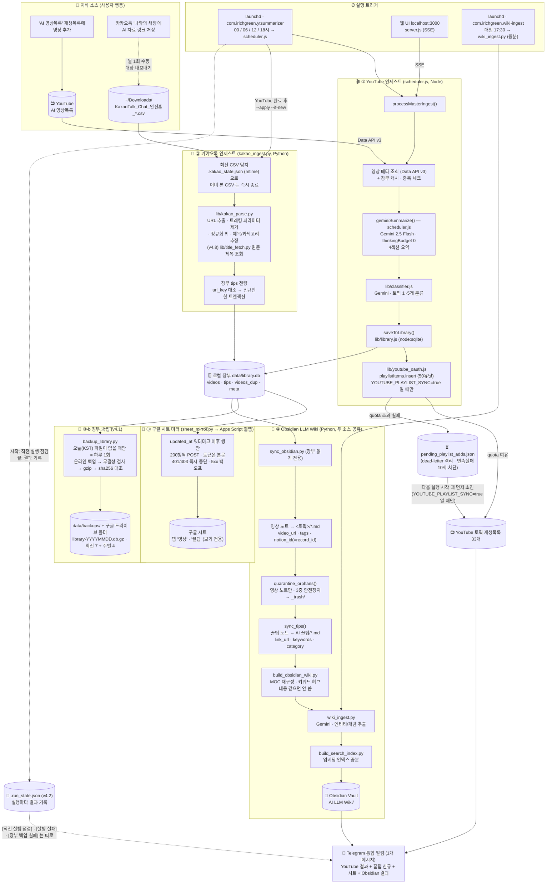

# 🎬 YouTube + 📎 카카오톡 → 로컬 장부 → Obsidian LLM Wiki (+ 구글 시트 미러)

**현재 버전: v4.11** (2026-10-14)

YouTube 재생목록의 영상을 **Gemini AI**로 자동 요약하고, 카카오톡 '나와의 채팅'에 저장해 둔 **AI 자료 링크**를 자동 수집하여
맥 안의 **로컬 장부**(SQLite 파일 `data/library.db`)에 적재한 뒤, **Obsidian**으로 동기화해 하나의 **LLM Wiki** 지식베이스로 합성하는 자동화 파이프라인입니다.
장부 내용은 **구글 시트**에 보기용 사본(미러)으로 자동 복사됩니다.

> v4.0 에서 노션을 뺐습니다. 원본 = 장부(`data/library.db`), 읽는 곳 = Obsidian, 보는 곳 = 구글 시트(단방향 미러). 파이프라인에 노션 호출이 없습니다.
> v4.1: 장부를 하루 1회 로컬(`data/backups/`)과 구글 드라이브에 자동 백업합니다(최신 7개 + 주별 4개).
> v4.2: 실행이 통째로 실패하거나, 알림을 못 보냈거나, 정시 실행이 빠지면 텔레그램으로 알립니다(못 보낸 알림은 다음 실행이 보냄).
> v4.3: 노션 해지(2026-10-12)에 따라 노션 모듈·`.env NOTION_*` 를 지웠습니다. 장부 ↔ Vault 대조는 `scripts/verify_library.py` 입니다.
> v4.4: 카톡 꿀팁의 추정 제목(「제목 미확인」·URL 조각)을 원문 제목으로 고치는 `scripts/retitle_tips.py` 를 넣었습니다 — 장부·Obsidian 노트(파일명 포함)·링크를 함께 바꿉니다.
> v4.5: Wiki 합성 결과(엔티티·개념)를 장부 `wiki_extract` 에 쌓고 `_wiki` 페이지를 매번 전체로 다시 그립니다.
> v4.6-a: 신규 영상은 **실제 영상**(YouTube URL)을 Gemini 에 넣어 요약하고, 판매가 주목적·일반론·AI 무관 영상은 등급 `exclude` 로 표시해 Wiki 합성·검색에서만 뺍니다(노트는 그대로). 영상 입력이 안 되면 예전처럼 설명란으로 요약합니다.
> v4.6-b: 예전에 설명란만 보고 만든 요약 약 3,000편을 **실제 영상으로 천천히 다시 요약**합니다(정시 실행마다 최대 5편, 하루 20편, Gemini 3.5 Flash-Lite — 신규 영상 몫 3시간은 남겨 둠). 노트는 요약 절만 제자리에서 바뀌고, Wiki 합성은 실제 영상 요약 노트만 다시 추출합니다.
> v4.7: Wiki 검색 화면을 개편했습니다 — 처음 열면 전체 목록이 나오고, 토픽 여러 개·종류·날짜·조회수·채널 등으로 거르고, 머리줄을 눌러 정렬합니다. 비슷한 영상·노트 전체 보기·엑셀 내려받기도 됩니다(회사 디자인 시스템 DS 1.1.23).
> v4.8: 카톡 꿀팁을 넣을 때 링크의 **원문 제목**을 자동으로 가져옵니다(노션 공개 페이지·유튜브·일반 웹페이지). 못 가져오면 예전처럼 URL 로 추정한 제목과 「원문 확인 필요」 메모가 들어갑니다.
> v4.9: 꿀팁 분류를 바로잡았습니다 — 노션에 올린 자료가 전부 「지식관리」로 잡히던 문제와 한글 「클로드」·「노션」 등이 태그로 안 잡히던 문제를 고치고, 이미 들어간 꿀팁도 규칙이 매긴 것만 다시 분류했습니다(사람이 고른 분류는 그대로). 옛 꿀팁의 출처 `https://…` 도 호스트만 남겼습니다.
> v4.10: 노션에서 넘어올 때 기본값(「기타」·태그 없음)이 그대로 남은 꿀팁도 규칙으로 다시 분류하고, URL 로 추정한 제목이 남아 있던 꿀팁 25건에 원문 제목을 넣었습니다 — 「기타」 66 → 42건.
> v4.11: 기존분 재요약이 Gemini 서버 오류(503)를 받으면 오래 재시도하지 않고 그 실행의 재요약을 바로 멈춥니다(1편에 약 13분 → 1~2분). 같은 영상이 3번 막히면 그 영상은 건너뜁니다.
> 2026-10-12: 저장소·폴더 이름을 `AI_Wiki_Pipeline` 으로 바꿨습니다(옛 이름 `YouTube_Notion_Grab` — 옛 주소는 GitHub 이 새 주소로 넘겨 줍니다).
> v3.0부터 지식 소스는 **YouTube 영상 + 카카오톡 링크** 두 갈래이고, 장부 이후 단계(Obsidian 노트 → Wiki 합성 → MOC)는 두 소스가 공유합니다.

---

## 🚀 프로젝트 개요
본 프로젝트는 AI 에이전트 기술을 활용하여 구현 및 고도화되었습니다.
* **AI Assistant**: Claude (Anthropic) — Agentic Coding
* **AI Model**: **Gemini 2.5 Flash** — YouTube 영상 요약 및 분류 엔진
* **Coding Style**: **Vibe Coding** (AI-driven iterative design & implementation)

---

## ✨ 주요 기능

- 🎥 **YouTube 재생목록 자동 수집** — YouTube Data API v3로 재생목록 영상 전체 조회
- 🤖 **Gemini AI 자동 요약** — 영상 제목·설명·태그 기반 4섹션 보고서 자동 생성
- 🗄️ **로컬 장부 저장 (v4.0)** — 요약 결과를 맥의 SQLite 파일 `data/library.db` 에 저장 (외부 서비스 의존 없음)
- 🔄 **스마트 중복 방지** — 장부 전량을 캐시로 읽어 메모리에서 즉시 중복 체크 ("전부 읽었거나, 던지거나")
- 📊 **통계 자동 업데이트** — 조회수·구독자수 15% 이상 변화 시만 갱신
- 📎 **카카오톡 링크 자동 수집 (v3.0)** — '나와의 채팅' 내보내기 CSV에서 AI 자료 링크를 추출·정규화해 장부 `tips` 에 신규만 적재 (장부 대조 기반 멱등성)
- 📓 **Obsidian 자동 동기화** — 장부의 영상·꿀팁 신규 항목을 Obsidian 노트로 생성, LLM Wiki 자동 합성
- 📗 **구글 시트 미러 (v4.0)** — 장부의 영상·꿀팁을 구글 시트 두 탭에 보기용으로 복사 (매 실행 끝에 변경분만)
- 🛟 **장부 자동 백업 (v4.1)** — 하루 1회 장부 스냅샷(무결성 검사 + gzip)을 로컬 `data/backups/` 와 구글 드라이브 폴더에 저장, 최신 7개 + 주별 4개 보관
- 🔗 **Wiki 링크 자동 구성** — 재생목록별 MOC, 채널별 목차, 키워드 링크 자동 생성 (내용이 같으면 파일을 다시 쓰지 않음)
- 🔎 **Wiki 검색 (v3.2)** — 이 맥·집 안 다른 컴퓨터·Claude(MCP)에서 의미 검색 + AI 답변
- 📱 **텔레그램 알림** — 장부 저장·카톡·시트·Obsidian 결과 통합 전송
- 🚨 **실행 실패 알림 (v4.2)** — 영상을 하나도 확인하지 못한 실행·치명적 오류는 바로, 네트워크가 죽어 못 보낸 알림·도중에 멈춘 실행·빠진 정시 실행은 다음 실행이 알림 (`.run_state.json`)
- ⏰ **launchd 자동 스케줄링** — Mac 로그인 시 서버 자동 시작, 6시간 간격 스케줄러 실행

---

## 🏗️ 시스템 아키텍처 (v4.2)

### 전체 데이터 흐름



### 한 사이클(6시간)에서 실제로 일어나는 일

| 순서 | 단계 | 실행 주체 | 입력 | 출력 | 아무 것도 없을 때 |
|:--:|---|---|---|---|---|
| 0 | 직전 실행 점검 (v4.2) | `scheduler.js` | `.run_state.json` | 못 보낸 실패·끝나지 못한 실행·9시간 넘는 간격이면 `[직전 실행 점검]` 텔레그램 | 첫 실행·정상이면 생략 |
| 1 | 대기 큐 소진 | `scheduler.js:flushPendingQueue()` | `pending_playlist_adds.json` | 재생목록 추가 (quota 한도 내) | 큐 비어 있으면 생략. `YOUTUBE_PLAYLIST_SYNC=false` 면 건너뜀 |
| 2 | YouTube 마스터 인제스트 | `scheduler.js` | 'AI 영상목록' 신규 영상 | 요약(`geminiSummarize`) → 토픽 분류(`lib/classifier.js`) → 장부 `videos` 행 → 토픽 재생목록 추가(`YOUTUBE_PLAYLIST_SYNC=true` 일 때만) | 장부 캐시 대조 후 0건 처리 |
| 2b | 실행 결과 기록 (v4.2) | `scheduler.js` | 1·2 결과 | `.run_state.json` · 저장 0 · Skip 0 · 오류 ≥1 이면 `[실행 실패]` 텔레그램 | 정상이면 기록만 |
| 3 | 카톡 인제스트 | `kakao_ingest.py --apply --if-new` | `~/Downloads` 최신 CSV | 장부 `tips` 신규 행 | 같은 CSV(mtime)면 장부 조회 없이 즉시 종료 |
| 4 | 시트 미러 (v4.0) | `sheet_mirror.py` | 장부 중 `updated_at` > 워터마크 | 시트 '영상'·'꿀팁' 탭 덮어쓰기/추가 | 바뀐 행 0이면 요청 0. `.env` 미설정이면 건너뜀 |
| 4b | 장부 백업 (v4.1) | `backup_library.py` | 장부 전체 (읽기 전용) | `data/backups/`·드라이브 폴더의 `library-YYYYMMDD.db.gz` | 오늘(KST) 파일이 있으면 건너뜀 → 실제로는 하루 1회. 실패는 텔레그램 별도 알림 |
| 5 | 영상 노트 동기화 | `sync_obsidian.py` | 장부 `videos` | `VAULT/<토픽>/*.md` | 0건 |
| 6 | 고아 격리 | `sync_obsidian.py:quarantine_orphans()` | Vault 영상 노트 vs 장부 | `_trash/<ts>/` 이동 | 3중 안전장치 하나라도 걸리면 아무것도 안 함 |
| 7 | 꿀팁 노트 동기화 | `sync_obsidian.py:sync_tips()` | 장부 `tips` | `VAULT/AI 꿀팁/*.md` | 0건 |
| 8 | MOC·키워드 재구성 | `build_obsidian_wiki.py` | Vault 전체 | `_MOC/*.md`, 노트 하단 관련 항목 | 내용이 같으면 파일을 쓰지 않음 (v4.0) |
| 9 | Wiki 합성 | `wiki_ingest.py` | 미처리 노트 | `_wiki/entities`, `_wiki/concepts` | 신규 노트 없으면 생략 |
| 10 | 알림 | `scheduler.js` | 2·3·4·5~9 결과 | Telegram 1개 메시지 | 변경 0이면 발송 생략 (시트 실패는 알림 · 백업 실패는 별도 알림 · 실패 알림은 0·2b) |

### 두 소스의 격리 원칙

영상 노트와 꿀팁 노트는 **같은 Vault, 다른 폴더, 다른 프론트매터 키**를 쓴다. 이 구분이 고아 격리 안전장치를 지킨다.

| | 영상 노트 | 꿀팁 노트 (v3.0) |
|---|---|---|
| 폴더 | `<토픽명>/` (33개) | `AI 꿀팁/` (평면, 하위 폴더 없음) |
| 원본 링크 키 | `video_url` | `link_url` — **`video_url` 절대 금지** |
| 분류 키 | `tags: [..]` (장부 `topics` 와 동기화) | `keywords: [..]` + `category` — `tags` 없음 → 폴더명 MOC |
| 고아 격리 대상 | ✅ | ❌ (보고만, `RESULT_JSON.tips_orphans`) |
| 파일명 | `<채널>_<제목>_<날짜>.md` | `<저장일>_<제목>.md` (충돌 시 `_<id 끝 6자리>`) |
| Wiki 합성 | ✅ 본문 요약 기반 | ✅ 제목·태그·메모 기반 (본문이 거의 없어 추출 품질은 낮음) |

---

## 📂 프로젝트 구조

```
AI_Wiki_Pipeline/
├── server.js                          # 웹 서버 (127.0.0.1:3000) — UI · 마스터 인제스트 SSE · Wiki 검색
├── scheduler.js                       # 자동 스케줄러 (6시간 간격) — YouTube → 장부 → 카톡 → 시트 → 백업 → Obsidian → 알림
├── index.html                         # 웹 앱 UI (단일 파일)
├── package.json                       # Node.js CommonJS 설정
├── playlists.json                     # 등록된 재생목록 목록 (gitignore)
├── .env                               # API 키 (gitignore — 절대 커밋 금지)
├── data/library.db                    # (v4.0) 로컬 원본 장부 — SQLite (gitignore, 개인 요약 전체)
├── data/backups/                      # (v4.1) 장부 백업 library-YYYYMMDD.db.gz — 최신 7 + 주별 4 (gitignore)
├── .run_state.json                    # (v4.2) 직전 실행 결과 — 다음 실행이 실패·빠진 실행을 알리는 근거 (gitignore, 지워도 무해)
├── favicon.svg                        # 브라우저 탭 아이콘
├── oauth_setup.js                     # YouTube OAuth refresh_token 1회 발급 도구
├── kakao_ingest.py                    # 카톡 CSV → 장부 tips (기본 dry-run, --apply / --if-new)
├── sheet_mirror.py                    # (v4.0) 장부 → 구글 시트 미러 (변경분만, --dry-run / --full / --check)
├── gas/sheet_mirror.gs                # (v4.0) 시트 쪽 Apps Script 웹앱 (받는 쪽, 설치 순서는 파일 머리 주석)
├── backup_library.py                  # (v4.1) 장부 하루 1회 백업 → data/backups/ + 구글 드라이브 (--dry-run / --status / --force)
├── sync_obsidian.py                   # 장부 → Obsidian 증분 동기화 (영상·꿀팁 노트, 고아 격리, --dry-run)
├── build_obsidian_wiki.py             # MOC + 채널 목차 + 키워드 링크 빌더 (내용 같으면 안 씀)
├── wiki_ingest.py                     # Gemini 기반 엔티티/개념 추출 → 장부 wiki_extract 누적 → 위키 페이지 렌더 (v4.5, v4.6 grade: exclude 제외)
├── wiki_config.py                     # Wiki Ingest 공통 설정 및 Gemini 호출 유틸
├── build_search_index.py              # 검색 인덱스(임베딩) 증분 빌드 (프론트매터의 notion_id 기준, v4.6 grade: exclude 제외)
├── wiki_lan_server.js                 # (v3.2) 집 안 전용 읽기 전용 Wiki 검색 서버 (포트 3100)
├── wiki.html                          # Wiki 검색 화면 (server.js·wiki_lan_server.js 공용, v4.7 전체 목록·필터·정렬·엑셀·노트 보기)
├── wiki_mcp.js                        # Wiki 검색 stdio MCP (search_wiki, read_note)
├── com.irichgreen.*.plist             # launchd 원본 (server · ytsummarizer · wiki-ingest · wiki-lan) — 설치본과 같게 유지
├── install-*.sh                       # launchd 설치 스크립트 (server · scheduler · wiki-ingest)
├── deploy.sh                          # (옛) GitHub 일괄 업로드 스크립트 — 지금은 쓰지 않는다 (커밋·push 는 작업지시서로)
├── SKILL_SAFETY.md                    # 구글 API 안전 코딩 가이드 (401/403 즉시 중단 · 지수 백오프) — CLAUDE.md 보안 원칙의 원문
├── spec_sheet.html                    # (옛) v2.1 기술 명세서 — 기록용
├── google_ai_pro_policy_analysis.html # (옛) Google AI Pro 한도 변경 분석 리포트(2026-05) — 기록용
├── lib/
│   ├── library.js                     # (v4.0) 장부 Node 헬퍼 (openLibrary·insertVideo·addTopic·updateStats)
│   ├── library_db.py                  # (v4.0) 장부 Python 헬퍼 (open_existing — 없으면 만들지 않음)
│   ├── library_schema.sql             # (v4.0) 장부 스키마 원본 (user_version 3 = v4.6 videos.grade·quality·summarized_at)
│   ├── video_summary.js               # (v4.6) 실제 영상 요약 + 품질 신호 · 등급 규칙 · 하루 영상 분량 누계 (v4.6-b 모델 인자·대체 없음·신규 몫 예약)
│   ├── resummarize.js                 # (v4.6-b) 기존분 재요약 — 후보 선정·상한·건너뜀/실패/중단 처리 (scheduler.js 가 매 실행 호출)
│   ├── env_util.py                    # (v4.0) .env 읽기 (의존성 없음)
│   ├── youtube_oauth.js               # YouTube OAuth 2.0 + playlistItems.insert
│   ├── classifier.js                  # Gemini 기반 토픽 분류기
│   ├── wiki_search.js                 # Wiki 검색 코어 (임베딩 코사인 + 키워드 폴백)
│   ├── kakao_parse.py                 # URL 추출·정규화·중복 키·제목/카테고리 추정 (순수 함수)
│   └── title_fetch.py                 # (v4.8) 링크 원문 제목 조회 — 노션 공개 API · 유튜브 oEmbed · og:title
├── scripts/
│   ├── verify_library.py              # (v4.3) 장부 ↔ Vault 대조 (읽기 전용, 네트워크 없음)
│   ├── retitle_tips.py                # (v4.4) 꿀팁 제목 보완 — 장부·노트 파일명·링크 일괄 (dry-run 기본)
│   ├── recategorize_tips.py           # (v4.9) 꿀팁 분류 보정 — 규칙이 매긴 카테고리·태그(+ v4.10 「기타」·태그 없음) 다시 매김 · 출처 호스트만 (dry-run 기본)
│   ├── migrate_library.py             # (v4.5·v4.6) 장부 스키마 이전 1·2 → 3 (dry-run 기본, 백업 먼저)
│   ├── clean_pending_queue.js         # 대기 큐 중복 제거 + dead-letter 격리
│   ├── fake_gas_server.js             # (테스트) gas/sheet_mirror.gs 를 그대로 올린 가짜 Apps Script 서버
│   └── test_*.{js,py}                 # 회귀 테스트 14종 (네트워크 0회)
├── legacy_scripts/                    # (v4.0) 은퇴한 노션 전제 스크립트 보관 (실행 대상 아님)
├── docs/tasks/                        # Cowork → Claude Code 작업지시서 (날짜-슬러그.md) + patches/
├── docs/cowork-project-instructions.md # (옛) Cowork 프로젝트 인수인계 사본 (2026-08-17) — 현재 원본은 Cowork 프로젝트 설정
├── CLAUDE.md                          # 구조·제약·안전장치 — 코드 질문은 여기부터 (AGENTS.md 는 같은 내용)
└── README.md                          # 이 문서 (README.html 은 만들지 않는다)
```

---

## 🛠️ 기술 스택

| 분류 | 기술 |
|------|------|
| **Runtime** | Node.js (데몬 `/opt/homebrew/bin/node`, `node:sqlite` 사용), Python 3 (`/opt/homebrew/bin/python3`) |
| **Backend** | Node.js HTTP 서버 (`127.0.0.1` 전용) |
| **Frontend** | Vanilla HTML/CSS/JavaScript (Single File) |
| **AI 요약** | Google Gemini 2.5 Flash API |
| **데이터 소스** | YouTube Data API v3, 카카오톡 내보내기 CSV |
| **저장소** | 로컬 SQLite (`data/library.db`) — v4.0 |
| **보기용 사본** | 구글 시트 + Apps Script 웹앱 — v4.0 |
| **Wiki** | Obsidian (로컬 마크다운 지식베이스) |
| **알림** | Telegram Bot API, Gmail SMTP |
| **스케줄링** | macOS launchd |

---

## 🔑 환경 변수 설정 (.env)

프로젝트 루트에 `.env` 파일을 생성하세요. (GitHub에 절대 올리지 않습니다)

```env
YOUTUBE_API_KEY=AIzaSy...
GEMINI_API_KEY=AIzaSy...
GEMINI_API_KEYS=AIzaSy...,AIzaSy...                 # 무료 키 로테이션 (쉼표)

KAKAO_EXPORT_DIR=/Users/<사용자>/Downloads          # KakaoTalk_Chat_안진훈_*.csv 가 떨어지는 폴더
# (선택, v4.8) 꿀팁 원문 제목 조회 — 없으면 켜짐 · 실행당 60건 · 180초
# KAKAO_TITLE_LOOKUP=false
# KAKAO_TITLE_MAX=60
# KAKAO_TITLE_BUDGET=180

# (v4.0) 구글 시트 미러 — 둘 다 없으면 미러를 건너뛴다 (설치 순서: gas/sheet_mirror.gs 머리 주석)
SHEET_MIRROR_URL=https://script.google.com/macros/s/.../exec
SHEET_MIRROR_TOKEN=<openssl rand -hex 24 로 만든 값 — Apps Script 스크립트 속성 MIRROR_TOKEN 과 같게>

# (v4.1) 장부 백업 — 구글 드라이브 데스크톱 앱이 동기화하는 폴더 안. 없으면 로컬 data/backups/ 에만 만든다
LIBRARY_BACKUP_DIR=~/Library/CloudStorage/GoogleDrive-<계정>/내 드라이브/YouTube_Ledger_Backup

# (v4.5) Wiki 합성 backfill — 옛 소스를 묶어서 다시 추출. 영상 요약과 같은 Gemini 무료 키를 쓰므로 올리지 말 것
WIKI_BACKFILL_DAILY_MAX=30                          # 하루(태평양시) 호출 상한, 0 = 끔 (없으면 30). (v4.6-b) 대상은 실제 영상 요약 노트만
WIKI_BACKFILL_BATCH=20                              # 한 호출에 묶는 소스 수 1~40 (없으면 20)

# (v4.6) 실제 영상 요약 — 없으면 아래 기본값. false 면 예전처럼 설명란으로만 요약
VIDEO_SUMMARY=true
VIDEO_MAX_SECONDS=1800                              # 이보다 긴 영상은 앞부분만 (Gemini videoMetadata.endOffset)
VIDEO_DAILY_SECONDS=28800                           # 하루(태평양시) 영상 입력 분량 상한 — 무료 등급 8시간

# (v4.6-b) 기존분 재요약 — 없으면 아래 기본값. false 면 재요약만 끈다 (VIDEO_SUMMARY=false 도 재요약을 끈다)
RESUMMARY=true
RESUMMARY_MODEL=gemini-3.5-flash-lite               # 신규 요약(2.5 Flash)과 무료 한도가 모델별로 따로
RESUMMARY_PER_RUN=5                                 # 정시 실행 1회당 편수
RESUMMARY_DAILY_MAX=20                              # 하루(태평양시) 편수 — 장부 quality.resummary_day 로 센다
RESUMMARY_RESERVE_SECONDS=10800                     # 하루 영상 분량 상한에서 신규 영상 몫으로 남길 초(3시간)
RESUMMARY_MAX_5XX=1                                 # (v4.11) 영상 1편에 5xx 이 횟수면 재시도 없이 그 실행 재요약 중단 (0 = 신규와 같은 8회)

# (v3.2) 집 안 전용 Wiki 검색 서버 — 이 대역 + 루프백만 접속 허용. 없거나 틀리면 127.0.0.1 전용(fail-closed)
WIKI_LAN_ALLOW_CIDR=192.168.0.0/24                  # 예시값 — 실제 집 네트워크 대역으로 교체
WIKI_LAN_ASK_DAILY_MAX=20                           # AI 답변 24시간 총량 (Gemini 무료 한도 보호)

# (v4.0) 새로 만든 빈 장부로 처음 돌릴 때만 true. 평소에는 넣지 않는다 — 장부 0건이면 저장 없이 중단하는 안전장치를 끈다
# LIBRARY_ALLOW_EMPTY=true

TELEGRAM_ENABLED=true
TELEGRAM_BOT_TOKEN=1234567890:AAG...
TELEGRAM_CHAT_ID=1234567890

EMAIL_ENABLED=false
EMAIL_FROM=your@gmail.com
EMAIL_TO=recipient@email.com
EMAIL_APP_PASS=xxxx xxxx xxxx xxxx

# YouTube OAuth 2.0 — 토픽 재생목록 자동 추가용. oauth_setup.js 실행 후 자동 기입
YOUTUBE_OAUTH_CLIENT_ID=...
YOUTUBE_OAUTH_CLIENT_SECRET=...
YOUTUBE_OAUTH_REFRESH_TOKEN=...
YOUTUBE_MASTER_PLAYLIST_ID=PLxxxxxxxxxxxxxxxxxxxxxxxx
YOUTUBE_PLAYLIST_SYNC=true                          # false 면 토픽 재생목록 추가·대기 큐 재시도를 건너뛴다 (요약·분류·장부 저장은 그대로). 현재 운영값 false
```

---

## 📦 설치 및 실행

### 1. 사전 요구사항
- Node.js 22.13 이상 (`node:sqlite` 를 플래그 없이 쓰는 버전. 데몬은 Homebrew `/opt/homebrew/bin/node`), Python 3 (Homebrew `/opt/homebrew/bin/python3`)
- YouTube Data API v3 키, Google Gemini API 키
- 장부 `data/library.db` (원본 — 새로 만들지 않는다. 없으면 백업에서 복원)

### 2. 서버 및 스케줄러 실행
```bash
# 서버 수동 실행
node server.js

# Mac 자동 시작 등록
bash install-server.sh
bash install-scheduler.sh
bash install-wiki-ingest.sh
```

launchd 데몬 4개 (설치본 = `~/Library/LaunchAgents/`, 원본 = 레포 루트 plist):

| 라벨 | 실행 대상 | 스케줄 | 설치 |
|---|---|---|---|
| `com.irichgreen.server` | `server.js` (127.0.0.1:3000) | 상주 (로그인 시 시작) | `install-server.sh` |
| `com.irichgreen.ytsummarizer` | `scheduler.js` | 00 / 06 / 12 / 18시 | `install-scheduler.sh` |
| `com.irichgreen.wiki-ingest` | `wiki_ingest.py` (증분) | 매일 17:30 (Gemini 일 한도 리셋 직후) | `install-wiki-ingest.sh` |
| `com.irichgreen.wiki-lan` | `wiki_lan_server.js` (포트 3100) | 상주 | 아래 「6. Wiki 검색」 |

로그는 `~/Library/Logs/irichgreen/` (스케줄러 상세 로그는 레포 루트 `scheduler.log`).

### 3. 카카오톡 링크 인제스트

```bash
# 카카오톡 PC → '나와의 채팅' → 대화 내보내기 → ~/Downloads 에 CSV 저장 (월 1회 정도)
# 이후는 스케줄러가 자동 처리한다. 수동으로 돌릴 때는 반드시 dry-run 부터.
/opt/homebrew/bin/python3 kakao_ingest.py                    # dry-run — 생성될 행을 표로만 출력
/opt/homebrew/bin/python3 kakao_ingest.py --apply --limit=3  # 3건만 → 장부 확인
/opt/homebrew/bin/python3 kakao_ingest.py --apply            # 전량
/opt/homebrew/bin/python3 kakao_ingest.py --no-lookup        # (v4.8) 원문 제목 조회 없이 — 링크를 열지 않는다
/opt/homebrew/bin/python3 lib/title_fetch.py <URL>           # (v4.8) 링크 하나 제목 조회만 해 보기

# (v4.4) 추정 제목(「제목 미확인」·URL 조각)을 원문 제목으로 — CSV: record_id,old_title,new_title
/opt/homebrew/bin/python3 scripts/retitle_tips.py <CSV>          # dry-run — 바뀔 제목·파일명·링크 수
/opt/homebrew/bin/python3 scripts/retitle_tips.py <CSV> --apply  # 장부·노트·링크 + Wiki 재구성·검색 인덱스

# (v4.9) 규칙이 매긴 꿀팁 카테고리·태그를 지금 규칙으로 · 옛 출처 https:// 접두 정리 (사람이 고른 분류는 그대로, v4.10 「기타」·태그 없음은 기본값이라 다시 매김)
/opt/homebrew/bin/python3 scripts/recategorize_tips.py          # dry-run — 바뀔 행·카테고리 이동 표
/opt/homebrew/bin/python3 scripts/recategorize_tips.py --apply  # 정시 실행 창(매시 50분~다음 시 20분) 밖에서
```

### 4. 구글 시트 미러 (v4.0)

1. 구글 시트를 하나 만들고 확장 프로그램 → Apps Script 에 `gas/sheet_mirror.gs` 를 붙여 넣는다.
2. 맥에서 토큰을 만들어 `.env` 의 `SHEET_MIRROR_TOKEN` 과 Apps Script 스크립트 속성 `MIRROR_TOKEN` 에 같은 값을 넣는다.
3. 웹 앱으로 배포(실행 계정 "나", 액세스 "모든 사용자") → URL 을 `.env` 의 `SHEET_MIRROR_URL` 에 넣는다.
4. 첫 전송과 대조:

```bash
/opt/homebrew/bin/python3 sheet_mirror.py --dry-run   # 보낼 건수만 (네트워크 0)
/opt/homebrew/bin/python3 sheet_mirror.py             # 처음엔 두 탭을 비우고 전부 보낸다 (약 3천 행, 요청 18회 = 탭 비우기 2 + 영상 15 + 꿀팁 1)
/opt/homebrew/bin/python3 sheet_mirror.py --check     # 시트 행 수 = 장부 행 수 인지
```

> 시트는 보기 전용 사본이다. 시트를 고쳐도 장부로 돌아가지 않고, 다음 변경 때 덮어써진다. 열을 추가하지 말 것(머리글이 다르면 쓰기를 멈춘다 → `--full`).

### 5. 장부 백업 (v4.1)

장부는 이 맥에만 있는 원본이다. 스케줄러가 매 실행 끝에 `backup_library.py` 를 부르고, 오늘(KST) 백업이 없는 곳에만 만든다 — 실제로는 00시 실행이 하루 1개를 만든다.

1. 구글 드라이브 데스크톱 앱에 로그인해 둔다.
2. `.env` 에 `LIBRARY_BACKUP_DIR` 를 넣는다(위 환경 변수 절). 마지막 폴더는 스크립트가 만들지만, 그 부모(`내 드라이브`)가 없으면 만들지 않고 실패로 알린다.
3. 확인:

```bash
/opt/homebrew/bin/python3 backup_library.py --dry-run   # 만들 곳·지울 파일만 (쓰기 0)
/opt/homebrew/bin/python3 backup_library.py             # 오늘 것 만들기 (이미 있으면 건너뜀)
/opt/homebrew/bin/python3 backup_library.py --status    # 두 곳의 개수·가장 최근 날짜
```

- 파일: `library-YYYYMMDD.db.gz`(약 4MB). SQLite 온라인 백업 → `integrity_check` → gzip → 압축을 다시 풀어 sha256 대조. 장부는 읽기 전용으로만 연다.
- 보관: 최신 7개 + 그보다 옛 주마다 1개씩 4주 = 최대 11개(약 45MB). 이름 형식이 다른 파일은 지우지 않는다.

**복원** (손으로, 스케줄러가 돌지 않는 시간에):

```bash
launchctl unload ~/Library/LaunchAgents/com.irichgreen.ytsummarizer.plist
cp data/library.db data/library.db.bak.$(date +%Y%m%d_%H%M%S)      # 지금 것을 먼저 보관
gunzip -c data/backups/library-YYYYMMDD.db.gz > data/library.db.restore
sqlite3 data/library.db.restore 'PRAGMA integrity_check'           # ok 확인
mv data/library.db.restore data/library.db
launchctl load ~/Library/LaunchAgents/com.irichgreen.ytsummarizer.plist
```

> v4.5 이전(10-12 이전) 백업은 `user_version` 1 이다. 복원 뒤 `mv` 전에 `/opt/homebrew/bin/python3 scripts/migrate_library.py --db=data/library.db.restore --apply` 로 올린다(안 올리면 모든 실행이 버전 불일치로 멈춘다).

> 복원하면 그 날짜 이후 저장된 영상이 장부에서 빠진다. 다음 실행이 그 영상을 신규로 다시 요약할 수 있고, Obsidian 에 남은 노트는 고아 격리 대상이 될 수 있다 — `sync_obsidian.py --orphans-dry-run` 부터 본다. 시트는 `sheet_mirror.py --full` 로 맞춘다.

### 6. Wiki 검색 (v3.2)

| 입구 | 프로세스 | 바인딩 | 용도 |
|---|---|---|---|
| `http://localhost:3000/wiki` | `server.js` | `127.0.0.1:3000` | 이 맥에서 직접 |
| `http://<맥이름>.local:3100/wiki` | `wiki_lan_server.js` | `0.0.0.0:3100` + 대역 필터 | 집 안 다른 컴퓨터(가족) |
| MCP `wiki-search` | `wiki_mcp.js` (stdio) | 없음 | Claude 대화 중 |

가족 공유 켜는 순서:
1. `.env` 에 `WIKI_LAN_ALLOW_CIDR`(집 네트워크 대역)·`WIKI_LAN_ASK_DAILY_MAX` 추가
2. `cp com.irichgreen.wiki-lan.plist ~/Library/LaunchAgents/ && launchctl load ~/Library/LaunchAgents/com.irichgreen.wiki-lan.plist`
3. macOS 방화벽에서 `node` 수신 연결 허용 (관리자 권한 필요 — 사람이 직접)

> 제약: 맥이 집에 켜져 있고 깨어 있을 때만 접속된다. 읽기 전용(검색·AI 답변)이며, 인제스트 실행 엔드포인트는 이 서버에 없다.

화면(v4.7):
- 처음 열면 전체 목록(최신순). 왼쪽 필터 — 종류(영상·꿀팁) · 토픽(여러 개, 「하나라도 / 모두」) · 올라온 날짜 · 조회수 · 요약 방식(영상을 보고 만든 요약만) · 채널 · 꿀팁 분류·중요도 · 지난 방문 뒤 새로 들어온 것. 필터 옆 숫자는 다른 조건에 맞춰 바로 바뀐다.
- 검색어를 넣으면 의미 점수 상위 200건을 관련 결과로 보고 그 안에서 거르고 정렬한다(임베딩 한도에 걸리면 글자 일치).
- 표 머리줄(제목·채널·토픽·올라온 날·조회수·관련도)을 누르면 정렬, 한 번 더 누르면 뒤집힌다. 표/카드 보기 전환. 줄을 누르면 펼쳐지고 「전체 요약 보기」로 노트 본문과 비슷한 영상 5개를 오른쪽 패널에서 본다.
- 「엑셀」은 지금 목록(필터·정렬 그대로)을 `ai-llm-wiki-YYYYMMDD.xlsx` 로 받는다(시트 「목록」·「조건」).
- 지금 화면 상태(검색어·필터·정렬·열린 노트)가 주소에 남아 북마크·공유할 수 있다. `/` 로 검색 칸, `Esc` 로 지우기·닫기.

---

## 📓 Obsidian LLM Wiki

장부에 저장된 AI 영상 요약·꿀팁을 Obsidian 지식베이스로 자동 변환하며, `wiki_ingest.py`를 통해 지식 간의 관계를 분석하여 위키 페이지를 합성합니다. 자세한 구조는 [CLAUDE.md](CLAUDE.md)를 참조하세요.

---

## 🗄️ 장부 구조 (`data/library.db`, v4.0 · user_version 3 = v4.6)

스키마 원본은 `lib/library_schema.sql` 하나다(Python·Node 가 같은 파일을 실행). 문자열은 NFC, 목록은 JSON 배열 문자열, 시각은 ISO 8601 UTC.

| 테이블 | 내용 | 시트 탭 |
|---|---|---|
| `videos` | 영상 1건 1행. `record_id`(노션에서 옮긴 행 = 노션 page id, 새 행 = uuid4 = Obsidian `notion_id`) · `video_id`(UNIQUE) · 제목 · 채널 · `topics` · 업로드일 · 조회수 · 구독자 · URL · `summary`(Gemini 요약 마크다운) · `summary_src`(`video` 실제 영상 요약 · `app` 설명란 요약 · 그 밖 노션 시절) · (v4.6) `grade`(keep·exclude·NULL 미판정) · `quality`(신호 JSON) · `summarized_at` — 등급·신호는 시트로 보내지 않는다 | **영상** |
| `tips` | 카톡 링크 1건 1행. 제목 · URL · `url_key`(중복 판정) · 출처(호스트) · `tags` · 카테고리 · 상태 · 중요도 · 저장일 · 메모 · `body_md`(본문) | **꿀팁** |
| `videos_dup` | 1단계 적재 때 같은 video_id 로 겹친 노션 페이지 보관본 (지우지 않음) | — |
| `wiki_extract` | (v4.5) Wiki 합성 추출 결과 — 소스(`record_id`)별 엔티티·개념·관계 JSON, `status`(ok·seed·failed)·`attempts`. `_wiki` 페이지는 이 표로 다시 그린다 | — |
| `meta` | `switched_at`(장부 원본 확정 시각) · `sheet_wm_videos`·`sheet_wm_tips`(시트에 보낸 마지막 `updated_at`) · `sheet_target` · `sheet_last_ok` · 1단계 적재 기록(`source`·`loaded_at`·`schema_version`·`notion_video_pages`·`notion_tip_pages`) | — |

시트 열 — **영상**: record_id · 업로드일 · 채널 · 제목 · 주제 · 조회수 · 구독자 · URL · 요약 · 저장 · 수정 / **꿀팁**: record_id · 저장일 · 제목 · URL · 출처 · 카테고리 · 태그 · 중요도 · 상태 · 메모 · 본문 · 저장 · 수정 (저장·수정은 KST).

---

## 🔄 버전 관리 (Version History)

본 프로젝트는 **`v[Major].[Minor]`** 형식의 단순화된 버전 규칙을 따릅니다.
- **Major**: 핵심 엔진 교체, 아키텍처 개편 등 대규모 변화
- **Minor**: 기능 개선, 버그 수정, 프롬프트 튜닝 등 마이너한 변화
- (예외) 기존 버전의 긴급 안정성 수정은 세 번째 자리를 쓴 적이 있다 — v3.2.1. 문서만 고친 변경은 버전을 올리지 않는다.

### 📌 요약 이력 (Summary Table)

| 버전 | 날짜 | 주요 내용 요약 |
| :-- | :--- | :--- |
| **v4.11** | 2026-10-14 | **재요약 5xx 조기 중단**: 재요약(3.5 Flash-Lite)이 503 을 받으면 신규와 같은 8회(키 4개 × 2) 재시도 — 503 이 1~2분 뒤에 와서 1편에 약 13분(10-14 00시). 이제 영상 1편에 5xx `RESUMMARY_MAX_5XX`(기본 1)회면 재시도 없이 그 실행의 재요약을 멈추고, 그 영상은 `quality.resummary_5xx` +1(3회면 건너뜀). 신규 영상 경로·429·네트워크 처리는 그대로. 회귀 테스트 14종 |
| **v4.10** | 2026-10-14 | **꿀팁 빈 기본값 재분류 · 제목 3차**: `recategorize_tips.py` 가 카테고리 「기타」 + 태그 없음(노션 이관 때 기본값 그대로)을 사람이 고른 값으로 보지 않고 다시 매긴다(`blank_default`, 19건 중 16건 이동). URL 추정 제목 25건 → 원문 제목(`retitle_tips.py`, 비공개 노션 1건 제외) 뒤 재분류. 재분류 28행 · 「기타」 66 → 42. 회귀 테스트 14종 |
| **v4.9** | 2026-10-13 | **꿀팁 분류 보정**: 노션 페이지 주소(`notion.site`·`notion.so`·`app.notion.com`)의 `notion` 이 태그 `Notion` → 「지식관리」로 잡히던 문제(지식관리 17건 중 14건)와 한글 「클로드」·「노션」·「제미나이」 등이 태그로 안 잡히던 문제 수정 — 분류 규칙을 `lib/kakao_parse.classify` 한 곳으로. 기존 꿀팁은 `scripts/recategorize_tips.py` 로 v4.8 규칙이 매긴 행만 다시 분류(사람이 고른 분류 91건 유지), 노션 이관 시절 71행 출처 `https://…` → 호스트만, 노트는 해당 줄만 제자리 수정. 회귀 테스트 14종 |
| **v4.8** | 2026-10-13 | **카톡 꿀팁 원문 제목 자동 조회**: `kakao_ingest.py` 가 URL 로만 제목을 추정해 「노션 자료 (제목 미확인)」·「유튜브 영상 (제목 미확인)」·URL 조각 제목이 쌓이던 문제 수정. 사용자 글이 없고 GitHub 레포가 아닌 링크는 `lib/title_fetch.py` 로 원문 제목을 조회(노션 공개 페이지 API · 유튜브 oEmbed · og:title) — 장부 쓰기 전, 요청당 8초·재시도 없음, 실패하면 예전 추정 제목. 실행당 60건·180초, `--no-lookup`·`.env KAKAO_TITLE_*`. 실제 꿀팁 148건 사전 조회 143 성공. 회귀 테스트 13종 |
| **v4.7** | 2026-10-13 | **Wiki 검색 화면 개편**: 처음 열면 전체 목록(필터·정렬은 브라우저), 건수 선택 제거, 토픽 다중 선택(하나라도·모두), 종류·날짜·조회수·채널·요약 방식·꿀팁 분류·새로 들어온 것 필터, 머리줄 정렬, 표/카드, 의미 검색은 상위 200건 안에서, 비슷한 영상(저장 벡터 — Gemini 호출 없음), 노트 전체 보기(`/api/wiki-note`, id 로만), 엑셀 내려받기. iRichGreen Design System DS 1.1.23. 인덱스에 화면 필터용 메타(임베딩 무관). 회귀 테스트 12종 |
| **v4.6-b** | 2026-10-13 | **기존분 재요약 + 노트 요약 절 제자리 교체 + backfill 재개**: 설명란 요약 약 3,000편(`summary_src != 'video'`)을 정시 실행마다 최대 5편 · 하루 20편씩 실제 영상으로 다시 요약(`lib/resummarize.js`, Gemini 3.5 Flash-Lite — 10-13 비교 5건 등급·신호 일치, 신규 영상 분량 3시간 예약, 실패하면 기존 요약 유지). `sync_obsidian.py` 가 재요약·등급 변경 노트의 요약 절만 교체(관련 항목 절 보존). Wiki backfill 은 실제 영상 요약 노트만(재요약 시 `wiki_extract` stale), 항목 0 `_wiki` 페이지는 안내 문구로. promo_main 에서 무료 자료 배포·구독 유도·끝에 잠깐 하는 자기 홍보 제외, bad_summary 사유 로그. 회귀 테스트 11종 |
| **v4.6-a** | 2026-10-13 | **실제 영상 요약 + 품질 필터(신규 영상부터)**: 설명란만 보고 "추론해서라도" 쓰던 요약이 빈약한 설명란에서 지어낸 내용이 되던 문제 수정. 공개 영상은 Gemini 2.5 Flash 에 YouTube URL 을 영상으로 넣어(LOW, 30분 넘으면 앞 30분) 요약 + 사실 신호를 받고, 등급은 코드 규칙(판매 주목적·일반론·AI 무관 → `exclude`). 삭제·비공개·403·한도는 설명란 요약으로 대체. 장부 user_version 3(`grade`·`quality`·`summarized_at`), 노트 프론트매터 `grade`·`summary_src`, `exclude` 는 Wiki 합성·검색에서만 제외. 회귀 테스트 10종 |
| **v4.5** | 2026-10-12 | **Wiki 합성 결과 누적**: `wiki_ingest.py` 가 개념·엔티티 페이지와 index 를 그 실행분만으로 다시 써서 페이지마다 1~10건만 남던 결함(05-12 도입 때부터) 수정. 추출 결과를 장부 새 표 `wiki_extract`(user_version 2, `scripts/migrate_library.py`)에 소스별로 쌓고 매 실행 전체로 다시 그림(내용 같으면 안 씀). 깨진 응답은 실패로 재시도(3회), 옛 페이지 항목 씨앗, 옛 소스 3천여 건은 20개 묶음 backfill(하루 30회, 약 6일). 회귀 테스트 9종 |
| **v4.4** | 2026-10-12 | **꿀팁 제목 보완 도구**: 카톡 인제스트가 URL 로만 추정한 꿀팁 제목(「유튜브 영상 (제목 미확인)」·`courses` 등, 46건 누적)을 원문 제목으로 고치는 `scripts/retitle_tips.py`(CSV 입력, dry-run 기본). 장부 `title`·`updated_at`(시트 미러 반영) + 자동 메모 비움, 「AI 꿀팁」 노트 제자리 수정·파일명 변경, Vault `[[링크]]` 치환을 함께 하고 쓰기 전에 장부·파일을 백업. 첫 적용 5건. 회귀 테스트 8종 |
| **v4.3** | 2026-10-12 | **노션 잔재 정리**: 노션 해지에 따라 `lib/tips_notion.py`·`scripts/notion_to_sqlite.py`(+ 테스트)와 `.env` 의 `NOTION_*` 3키를 지움. 계속 쓰던 장부 ↔ Vault 대조만 `scripts/verify_library.py` 로 떼어 냄(검사 항목·`RESULT_JSON` 동일, 테스트 16/16). 앱 코드 동작 무변경. |
| **v4.2** | 2026-10-12 | **실행 실패 알림**: "저장 0 · Skip 0 · 오류 ≥1"(영상을 하나도 확인하지 못한 실행)과 치명적 오류가 텔레그램 없이 지나가던 구멍을 막음. 실행 상태 파일 `.run_state.json` 으로 네트워크가 죽어 못 보낸 실패·끝을 기록하지 못한 실행·9시간 넘게 빈 간격(빠진 정시 실행)을 다음 실행이 `[직전 실행 점검]` 으로 알림. `sendTelegram` 이 성공 여부를 돌려주고 JSON 아닌 응답에 죽지 않음 |
| **v4.1** | 2026-10-12 | **장부 자동 백업**: 장부(`data/library.db`)를 하루 1회 SQLite 온라인 백업 → 무결성 검사 → gzip 해 로컬 `data/backups/` 와 구글 드라이브 폴더(`.env LIBRARY_BACKUP_DIR`)에 저장(`backup_library.py`). 최신 7개 + 주별 4개 보관. 장부는 읽기 전용으로만 연다. 스케줄러 훅은 reject 없음, 실패는 텔레그램. 회귀 테스트 7종 |
| **v4.0** | 2026-10-12 | **노션 탈퇴 — 로컬 장부 + Obsidian + 구글 시트 미러**: 원본을 노션에서 맥의 SQLite 장부 `data/library.db` 로 옮김(1단계 적재 · 2단계 쓰기/읽기 전환 · 3단계 정리, 단계마다 실데이터 판정). 파이프라인 노션 호출 0. 장부 → 구글 시트(탭 영상·꿀팁) 단방향 미러 `sheet_mirror.py` + Apps Script 웹앱 `gas/sheet_mirror.gs`(변경분만, 인증 오류 즉시 중단). 앱의 노션 코드 의존 제거, `/api/sync-obsidian` 제거, 재구성 시 내용 같은 파일 안 쓰기(Vault 전체 mtime 갱신 해소). 회귀 테스트 6종 |
| **v3.2.1** | 2026-10-05 | **스케줄러 네트워크 안전장치 — 빈 캐시 중복 저장 차단**: Notion 캐시 첫 조회가 네트워크 오류로 실패하면 재시도 없이 빈 캐시로 진행해 재생목록 앞 15편을 다시 저장하던 결함 수정(08-12 이후 13회·중복 195건). 캐시는 "전부 읽었거나, 던지거나"로 바꾸고 실패한 실행은 영상 처리를 건너뜀(fail-closed), Notion 401/403 은 즉시 종료. YouTube 조회에 일시 오류 지수 백오프 재시도 추가(오류 한 번에 실행이 통째 실패하던 비율 28%). 채널 구독자 수 조회를 채널당 1회·동시 호출(약 450회)에서 50개 배치 순차(9회)로 교체. 회귀 테스트 `scripts/test_scheduler_guards.js` 신설 |
| **v3.2** | 2026-10-03 | **집 안 전용 Wiki 검색 서버**: 가족이 같은 네트워크의 다른 컴퓨터에서 `http://<맥이름>.local:3100/wiki`로 검색하도록 읽기 전용 서버 `wiki_lan_server.js` 신설. `server.js`(Notion 쓰기 프록시·인제스트 실행 포함)는 `127.0.0.1` 전용으로 유지하고 검색 경로만 분리 노출. 허용 대역(`WIKI_LAN_ALLOW_CIDR`) 밖 403, 미설정 시 루프백 전용(fail-closed), Host 검사, AI 답변 일일 총량으로 Gemini 무료 한도 보호. `launchd` `com.irichgreen.wiki-lan` 추가 |
| **v3.1** | 2026-09-10 | **Wiki 인제스트 할당량 소모 구조 교정**: Gemini 429를 `quotaId`로 RPD/RPM 분기(분당 한도 한 번에 키를 하루치 폐기하던 손실 제거), 5xx·네트워크 오류 지수 백오프 추가(전체 오류의 24%가 재시도 없이 버려지던 자리), 무료 티어 일 경계를 태평양시로 교정. `--rebuild` 경로로 띄운 wiki_ingest 의 출력을 `wiki-ingest.log` 에 합류시켜 실행 경로 2개를 한 로그에서 판정 가능하게 함 |
| **v3.0** | 2026-09-06 | **지식 소스 2원화 — 카카오톡 링크 파이프라인 통합**: 카카오톡 '나와의 채팅' CSV → Notion「AI 꿀팁」DB → Obsidian `AI 꿀팁/` 노트 → 기존 Wiki 합성·MOC 를 그대로 공유. `kakao_ingest.py`·`lib/kakao_parse.py`·`lib/tips_notion.py` 신규, `sync_obsidian.py:sync_tips()`, `scheduler.js` 훅(`--apply --if-new`), 텔레그램 통합 알림. 영상 노트와 꿀팁 노트의 격리 원칙 확립. `README.html` 폐지 |
| **v2.7.1** | 2026-08-28 | **토픽 분류의 일시적 서버 오류(5xx) 재시도 추가**: 요약 경로는 503에 키 로테이션 + 재시도로 대응하는 반면 분류 경로는 429/quota만 재시도 대상이라 503 한 번에 영상이 떨어지던 비대칭을 교정하고, 재시도 소진 시 발생하던 잠복 TypeError 경로를 차단 |
| **v2.7** | 2026-08-19 | **재생목록 쓰기 성공/실패 계측 및 알림 교정**: `.quota_state.json`이 성공·실패를 구분하지 않아 "시도했으나 전부 실패한 날"을 감지하지 못하던 구멍을 막고, 텔레그램 알림에 당일 배수량·유입량·순감 기준 소진 예상일을 표기 |
| **v2.6** | 2026-08-17 | **quota 일 경계 태평양시(PT) 교정**: `.quota_state.json`의 날짜 키가 UTC라 KST 09:00에 리셋되는 반면 YouTube 실제 quota는 PT 자정(KST 16:00)에 리셋되어, 그 7시간 동안 스로틀이 무력화되던 문제를 교정 |
| **v2.5** | 2026-08-17 | **재생목록 대기큐 정합성 및 API 어뷰징 차단**: 중복 적재 원천 차단, 영구 실패 dead-letter 격리(재시도 5회 상한), 연속 실패 10회 시 큐 처리 즉시 중단, 실패 요청의 quota 계상 누락 교정, 텔레그램 큐 적체 알림 추가 |
| **v2.4** | 2026-07-08 | **주제 분류 API 키 로테이션 적용 및 안정성 강화**: 주제 분류 단계(`classifyTopics`)에서 429 에러(할당량 초과) 발생 시 다음 API Key로 자동 전환(`rotateGeminiKey()`) 후 재시도하는 로직을 추가하여 무중단 인제스트의 안정성을 극대화함 |
| **v2.3** | 2026-06-02 | **비용 최적화 및 무료 Key 로테이션 적용**: 요약 스케줄러 내 누락되었던 비용 절감 옵션 추가 적용 및 다중 무료 API 키 로테이션 구축으로 비용 0원 가동 환경 마련 |
| **v2.2** | 2026-05-21 | **API 보안 킬스위치 및 안전장치 강화**: API 키 정지 감지 시 프로세스 즉시 종료, 스케줄러 영구 언로드, 보안 스킬 규정 지정 |
| **v2.1** | 2026-05-18 | **요약 안정성 극대화 및 지식베이스 정상화**: 요약 짤림 완전 방지, RAG 기술 분류 보강 및 3MB 오류 큐 정리 |
| **v2.0** | 2026-05-16 | **할당량 최적화 및 안정성 강화**: 배치 크기 하향 및 순차 처리 도입 |
| **v1.2** | 2026-05-12 | **Karpathy LLM Wiki & 비용 최적화**: Wiki Ingest 구현 및 비용 85% 절감 |
| **v1.1** | 2026-05-02 | **개발 환경 및 분류 지능화**: CLAUDE.md 도입 및 바이브코딩 매핑 강화 |
| **v1.0** | 2026-04-10 | 프로젝트 초기화 및 핵심 파이프라인 구축 단계 |

---

### 📝 상세 변경 내역 (Detailed Change Log)

#### [v4.11] — 2026-10-14 (⏱️ 재요약 5xx 조기 중단)

**배경.** 10-14 00:00 실행에서 재요약 1편(`RtGvzYeZ9gs`)이 Gemini 3.5 Flash-Lite 503 을 8회(키 4개 × 2) 받고 실패했다. 503 응답이 1~2분 뒤에 와서 00:03:38 → 00:16:20, 약 12분 42초 — 실행 16분 15초의 대부분이었다. 신규 영상(2.5 Flash)의 503 은 약 20초 안에 오고 1~2회 재시도 뒤 성공하는 것과 달랐다. 재요약은 신규보다 뒷순위이고 실패하면 기존 요약을 그대로 두므로(다음 실행이 이어서) 오래 붙잡을 이유가 없다.

| 항목 | 내용 |
|---|---|
| 요약기 | `lib/video_summary.js` `makeVideoSummarizer` 선택 인자 `maxServerErrors` — 영상 1편에서 5xx 응답이 이 횟수에 이르면 재시도를 그만두고 `video_http_5xx` 로 실패. 429·네트워크 오류는 세지 않는다(그대로 키를 돌림). 주지 않으면(0) 예전대로 키 4개 × 2회 — 신규 영상 경로는 넘기지 않는다 |
| 재요약 | `lib/resummarize.js` — `RESUMMARY_MAX_5XX`(기본 1, 0 = 상한 없음)를 요약기에 넘긴다. 5xx 로 멈추면 그 실행의 재요약 중단(예전과 같음) + 그 영상 `quality.resummary_5xx` +1, **3회면 건너뜀**(`resummary_skip = '5xx:video_http_503'`) — 후보가 최신 업로드부터라 같은 영상이 매 실행 맨 앞에서 막을 수 있다 |
| 장부 | `lib/library.js:markResummary` 에 `server` — `quality` 만 바꾸고 `updated_at` 은 그대로(시트 재전송 없음). 스키마 무변경(user_version 3) |
| 기대 효과 | 재요약 503 1편: 약 13분 → 1~2분. 로그 `⏹  영상 요약 503 — 재시도 그만 (5xx 1/1)` · `🔁 재요약: … 중단 video_http_503` |
| 무변경 | 신규 영상 요약 재시도 · 403 연속 2회 끔 · 429 키 회전 · 하루 분량·상한 · `bad_*` 실패 2회 건너뜀 |
| 테스트 | `scripts/test_video_summary.js` 25/25(+2), `scripts/test_resummarize.js` 11/11(+2). 회귀 테스트 14종 |
| 지시서 | `docs/tasks/2026-10-14-v411-resummary-5xx-stop.md` |


#### [v4.10] — 2026-10-14 (🗂️ 꿀팁 빈 기본값 재분류 · 제목 3차)

**배경.** v4.9 뒤 「기타」가 66건이었다. 그중 사람이 고른 값 43건 — 태그가 빈 19건은 「클로드 코드 토큰 3배로 오래 쓰는 무료 도구 3개」처럼 내용이 뻔한데 노션 시절 기본값(기타·태그 없음)이 그대로 남은 것이었다. 또 09-12~10-10 에 들어온 26건은 제목이 URL 추정(`agent reach`·`mobilebasic`·`view` 등)이었다 — v4.8 자동 조회는 새로 들어오는 행만 대상이다.

| 항목 | 내용 |
|---|---|
| 빈 기본값 | `scripts/recategorize_tips.py` `decide()` — 카테고리 「기타」 + 태그 없음은 v4.8 규칙 값이 아니어도 다시 매긴다(`BLANK_DEFAULT`). 태그가 하나라도 있거나 「기타」가 아니면 지금처럼 사람이 고른 값. `RESULT_JSON.blank_default`(분류가 바뀐 빈 기본값 행 수) · 로그 「(빈 기본값)」 |
| 제목 3차 | `docs/tasks/2026-10-14-retitle-tips-3.csv` 25건 — `lib/title_fetch.py` 로 조회한 원문 제목. 사이트 이름 꼬리(「— REBORN LABS」 등)·`.pdf` 는 뺐다. 비공개 노션 1건은 그대로(「원문 확인 필요」) |
| 순서 | `retitle_tips.py` → `recategorize_tips.py` — 제목이 바뀐 행은 새 제목으로 다시 분류된다(URL 추정 제목은 판정 글자에서 빠졌었다) |
| 사전 검증 | 장부 사본 + Vault 사본: 제목 25행 · 노트 25 · 링크 59(12파일) → 재분류 28행(빈 기본값 16 · 제목 따라 12) — 기타→개발툴 9 · →프롬프트 8 · →모델/LLM 7 · 모델/LLM→개발툴 1, 사람이 고른 값 유지 75, 노트 건너뜀 0, 두 번째 실행 0행. 카테고리 개발툴 51 · 기타 42 · 모델/LLM 25 · 프롬프트 14 · 뉴스/트렌드 10 · 지식관리 3 · 사업/마케팅 3 |
| 무변경 | 분류 규칙(`kakao_parse.classify`) · 장부 스키마 · 시트 머리글 · 카톡 인제스트 흐름 |
| 테스트 | `scripts/test_recategorize_tips.py` 52/52(+7). 회귀 테스트 14종 |
| 지시서 | `docs/tasks/2026-10-14-v410-tips-blank-default.md` |


#### [v4.9] — 2026-10-13 (🗂️ 꿀팁 분류 보정)

**배경.** v4.8 사전 검증에서 세 가지가 보였다. ① 노션에 올린 자료는 주소에 `notion` 이 들어 있어 태그 `Notion` → 카테고리 「지식관리」가 됐다(지식관리 17건 중 14건이 클로드·GPT 자료). ② 규칙이 영문만 봐서 한글 「클로드」가 `Claude` 태그에 안 걸렸다(제목에 「클로드」가 있는데 `Claude` 태그가 없는 꿀팁 27건) — v4.8 부터 원문 제목(대개 한글)이 들어오므로 더 중요해졌다. ③ 노션 이관 시절 71행의 출처가 `https://…` 라 「채널별 목차」에서 같은 사이트가 둘로 갈렸다(규칙은 호스트만).

| 항목 | 내용 |
|---|---|
| 분류 규칙 | `lib/kakao_parse.classify(url, *texts)` 한 곳 — `guess_meta` 와 재분류 스크립트가 같이 쓴다. 노션 페이지 주소는 **호스트를 빼고** 판정(`notion.com` 회사 사이트는 그대로 `Notion`). 한글 별칭: 클로드(코드)·제미나이/제미니·지피티/오픈AI·노션·옵시디언·안티그래비티·올라마·허깅페이스(「커서」는 일반 명사라 제외). 태그 이름·순서·카테고리 값은 그대로 |
| 기존 꿀팁 | `scripts/recategorize_tips.py` — 카테고리·태그가 v4.8 규칙 값(URL+제목 또는 URL 만)과 같은 행만 다시 매긴다. 사람이 고른 값(노션 시절 · 9-03~9-06 정리분)은 그대로. URL 추정 제목은 판정 글자에서 뺀다 |
| 출처 | `http(s)://` 로 시작하면 호스트만(`www.` 제거). URL 호스트와 다르면 고치지 않고 보고 |
| 노트 | 「AI 꿀팁」 노트의 해당 줄만 제자리 수정 — 프론트매터 `channel`·`category`·`keywords`, 본문 카테고리·태그·출처 줄. 손으로 고친 노트는 그 행을 장부째 건너뛴다. 파일명·제목·관련 링크는 그대로 |
| 안전 | 기본 dry-run · 쓰기 전 `data/recategorize_backup/<시각>/`(장부 사본·노트 원본·manifest) · 장부는 한 트랜잭션(조건 = record_id + 옛 세 값) · 다시 돌리면 0건 · 반영 뒤 `build_obsidian_wiki`·`build_search_index` |
| 사전 검증 | 장부 사본 + Vault 꿀팁 폴더 사본: 148건 중 87행(분류 16 · 출처 71) — 지식관리→모델/LLM 6 · →기타 4 · →개발툴 3 · →프롬프트 1 · 기타→개발툴 1, 사람이 고른 값 유지 91, 노트 건너뜀 0, 두 번째 실행 0행 |
| 무변경 | 장부 스키마 · 시트 머리글 · 중복 판정 · 제목 · 카톡 인제스트 흐름 |
| 테스트 | 신규 `scripts/test_recategorize_tips.py` 45/45. 회귀 테스트 14종 |
| 지시서 | `docs/tasks/2026-10-13-v49-tips-recategorize.md` |

#### [v4.8] — 2026-10-13 (🏷️ 카톡 꿀팁 원문 제목 자동 조회)

**배경.** `kakao_ingest.py` 는 링크를 열지 않고 URL 로 제목을 추정했다. 노션 공개 페이지는 슬러그에 한글이 없으면 「노션 자료 (…)」, 유튜브는 「유튜브 영상 (제목 미확인)」, 그 밖은 URL 마지막 조각(`claude and n8n`, `view`, `mobilebasic`)이 제목이 됐다. 10-12·10-13 두 차례 `scripts/retitle_tips.py` 로 손으로 고쳤고(2차 43건), 그때 쓴 조회 방법(노션 공개 페이지 API · og:title)이 44건 중 43건에서 통했다.

| 항목 | 내용 |
|---|---|
| 조회 대상 | 신규 꿀팁 중 제목이 URL 추정인 것(`title_src == 'guess'`) — 사용자가 메시지에 글을 붙였거나 GitHub 레포면 조회하지 않는다 |
| 조회 방법 | `lib/title_fetch.py` — 노션(`*.notion.site`·`notion.so`·`app.notion.com`) 공개 페이지 API `syncRecordValuesMain`, 유튜브 oEmbed(YouTube Data API 할당량 무관), 그 밖 HTML 앞 512KB 의 og:title → twitter:title → `<title>` |
| 안전 | 요청당 8초 · 재시도 없음 · 예외를 던지지 않음. 장부 쓰기 **전**에 끝나고, 실패하면 예전 추정 제목·「원문 확인 필요」 메모 그대로. 실행당 60건·180초(`.env KAKAO_TITLE_MAX`·`KAKAO_TITLE_BUDGET`), 끄기 `--no-lookup`·`KAKAO_TITLE_LOOKUP=false` |
| 제목 정리 | NFC · 공백 정리 · 앞뒤 이모지 제거 · `|` → ` — ` · `[[`·`]]` 제거 · 사이트 꼬리(` : 네이버 블로그` 등) 제거 · 120자. 로그인·차단·일반 문구(「Notion — Where teams…」, 「Sign in」, 「Just a moment...」)는 쓰지 않음 |
| 결과 | 성공하면 제목 교체 + 메모 비움 + 태그·카테고리를 제목 글자까지 보고 정함. `RESULT_JSON.title_lookup {need, ok, fail, skipped}`, 스케줄러 로그 「📎 카톡 인제스트: … · 제목 조회 성공/대상」 |
| 사전 검증 | 실제 꿀팁 148건 조회 143 성공(비공개 노션 3 · id 없는 노션 주소 1 · JS 로 그리는 페이지 1 실패), 요청당 최대 3.4초 · 장부 사본에서 9-15 이후 44건을 지우고 같은 URL 로 인제스트 → 조회 42/42(GitHub 2 제외), 24초 |
| 무변경 | 장부·스키마·시트·Obsidian 동기화·이미 들어간 꿀팁(고칠 때는 여전히 `retitle_tips.py`) |
| 테스트 | 신규 `scripts/test_title_fetch.py` 43/43, `test_kakao_ingest.py` 37/37(+19). 회귀 테스트 13종 |
| 지시서 | `docs/tasks/2026-10-13-v48-kakao-title-lookup.md` |

#### [v4.7] — 2026-10-13 (🔎 Wiki 검색 화면 개편)

**배경.** 검색 화면은 검색어를 넣어야 결과가 나오고(최대 30건), 토픽은 하나만 고를 수 있었다. 3,162건을 훑어보거나 여러 조건으로 거를 방법이 없었다.

| 항목 | 내용 |
|---|---|
| 화면 | `wiki.html` 전면 교체 — 처음 열면 전체 목록, 건수 선택 제거, 필터(종류·토픽 다중·날짜·조회수·요약 방식·채널·꿀팁 분류·중요도·새로 들어온 것, 다른 조건에 맞춘 건수), 켜진 필터 칩, 머리줄 정렬, 표/카드, 줄 펼침, 노트 전체 보기 패널(관련 항목 링크로 이동), 비슷한 영상 5개, 엑셀 내려받기, URL 해시 상태, 휴대폰 서랍 필터 |
| 디자인 | iRichGreen Design System 웹 계층 DS 1.1.23 — 토큰만(CSS 변수), FilterChip·SegmentedControl, 표 30px 줄, 카드 그림자 없음, 가장 작은 글자 12px, 고정폭 숫자, 1만 이상 「만」 표기, 빈 값 `-`. 밝은 테마만 |
| 검색 | 의미 점수를 모든 노트에 매겨(`scores=1`) 상위 200건을 관련 결과로 — 그 안에서 거르고 정렬. 임베딩 실패면 글자 일치(0점 제외) |
| API | `/api/wiki-search` 에 `all=1`(전체 목록, gzip 약 0.73MB · ETag) · `scores=1` · `similar=<id>` 옵션, 새 읽기 전용 경로 `/api/wiki-note?id=`(경로를 받지 않음). 기존 `?q=&limit=` 그대로 |
| 인덱스 | `build_search_index.py` 가 `kind`·`subscriber_count`·`summary_src`·`link_url`·`category`·`importance`·`keywords` 를 더 담는다 — 임베딩 hash 무관(실 Vault 사본 실행 재사용 3,162 · 신규 임베딩 0) |
| 무변경 | 장부·스키마·스케줄러·Wiki 합성·시트 미러 |
| 테스트 | 신규 `scripts/test_wiki_search.js` 34/34, `test_build_wiki_index.py` 15/15(+4). 회귀 테스트 12종 |
| 지시서 | `docs/tasks/2026-10-13-v47-wiki-ui.md` |

#### [v4.6-b] — 2026-10-13 (🔁 기존분 재요약 + 노트 요약 절 교체 + backfill 재개)

**배경.** v4.6-a 는 신규 영상부터 실제 영상으로 요약했다. 장부의 옛 요약 약 3,000편은 여전히 설명란만 보고 만든 것이라 일부는 지어낸 내용이고, 그래서 Wiki backfill(옛 소스 재추출)을 정지해 두었다(`.env WIKI_BACKFILL_DAILY_MAX=0`). 10-13 비교에서 Gemini 3.5 Flash-Lite 는 2.5 Flash 와 등급·신호가 5/5 같았고(Python 강의 = not_ai, 컨설팅 모집 = promo_main 포함) 말 내용도 정확히 옮겼다 — 요약은 약 65% 길이. 같은 날 12:00 실행에서 무료 레퍼런스 키트를 나눠 주는 시연 영상이 promo_main 으로 제외됐다(오판).

| 항목 | 내용 |
|---|---|
| 재요약 | `lib/resummarize.js` — 후보 `summary_src != 'video'` · 건너뜀 표시 없음 · 최신 업로드부터. `scheduler.js` 가 신규 처리 뒤 매 실행 호출(던지지 않음, 저장·Skip·오류 집계 밖). 상한: 실행당 `RESUMMARY_PER_RUN` 5 · 하루(PT) `RESUMMARY_DAILY_MAX` 20(장부 `quality.resummary_day` 로 셈) · 하루 영상 분량 8시간 중 `RESUMMARY_RESERVE_SECONDS` 3시간은 신규 몫. 모델 `RESUMMARY_MODEL` 기본 `gemini-3.5-flash-lite`(`thinkingLevel: minimal` — 3.x 는 `thinkingBudget` 을 400 으로 거절) |
| 실패 | 대체 요약 없이 기존 요약 유지. 삭제·공개 아님·영상 토큰 0 → `quality.resummary_skip`(다시 안 함), 형식 실패 2회 → 건너뜀, 429·5xx·하루 분량·403 연속 → 그 실행 중단. 건너뜀·실패 표시는 `updated_at` 안 건드림 |
| 장부 | 성공 시 `summary`·`summary_src 'video'`·`grade`·`quality`·`summarized_at`·`updated_at`(시트 미러) + 그 소스 `wiki_extract` → `stale`(attempts 0). 스키마 무변경(user_version 3) |
| 노트 | `sync_obsidian.py:refresh_changed_notes` — 장부 `summary_src` 가 `video` 인데 노트 프론트매터와 다르면 요약 절(`▶ 영상 보기` 다음 `---` 부터 `🔗 관련 항목` 앞까지)만 교체 + `grade`·`summary_src` 맞춤. 경계를 못 찾으면 그대로 두고 `refresh_skipped` 로 보고. 장부 `grade` 만 고쳐도 노트가 따라옴 |
| Wiki | backfill 대상 = 실제 영상 요약 노트(`summary_src: video`)만. `stale` 행은 다시 추출될 때까지 페이지에 그대로. 항목 0 이 된 이름(목록 안)의 기존 페이지는 안내 문구 페이지로(지우지 않음), index 에서 빠짐 |
| 품질 신호 | `promo_main` 프롬프트에 "무료 자료·템플릿·키트 배포, 구독·댓글 유도는 판매 아님 — 돈을 받는 판매·모집만" 추가(좁힘 — 영상 끝·중간에 자기 강의를 잠깐 알리는 정도도 false). bad_summary 는 어느 검사에 걸렸는지 로그 1줄(`missing:…`·`short_tail:N`) |
| 처리량 | 하루 약 19편 → 공개 약 2,950편에 약 5개월 |
| 끄기 | `.env RESUMMARY=false`(재요약만) · `VIDEO_SUMMARY=false`(영상 입력 전부) |
| 테스트 | 신규 `scripts/test_resummarize.js` 9/9, `test_video_summary.js` 23/23(+6), `test_scheduler_guards.js` 33/33(+2), `test_sync_obsidian.py` 32/32(+8), `test_wiki_ingest.py` 64/64(+7). 회귀 테스트 11종 |
| 지시서 | `docs/tasks/2026-10-13-v46b-resummarize.md` |

#### [v4.6-a] — 2026-10-13 (🎬 실제 영상 요약 + 품질 필터, 신규 영상부터)

**배경.** `scheduler.js:geminiSummarize` 는 제목·채널·설명란·태그만 넣고 "정보가 부족해도 추론해서 반드시 작성"을 시켰다. 10-12 시험에서 설명란이 빈약한 `mW5k5CbO4sA` 「AI 데이터 활용」의 장부 요약(데이터 수집·정제·윤리)은 전부 지어낸 내용이었다 — 실제 영상은 VS Code 로 Python 문자열을 다루는 강의. 같은 시험에서 Gemini 에 YouTube URL 을 영상으로 넣으면 실제 내용을 요약했고, 판매 목적·일반론 같은 사실 판단은 맞았지만 모델이 매긴 A/B/C 등급은 컨설팅 판매 영상에도 A 를 줬다.

| 항목 | 내용 |
|---|---|
| 요약 | 공개 영상 → `fileData.fileUri` = YouTube URL, `MEDIA_RESOLUTION_LOW`(약 103토큰/초), 30분 넘으면 `videoMetadata.endOffset` 1800s. JSON 응답 `{summary_md(4절), signals{promo_main, generic, ai_related, has_demo, sponsored, reason}}`. 모듈 `lib/video_summary.js` |
| 등급 | 코드 규칙 — `promo_main`(제작자 자신의 강의·컨설팅·상품 판매가 주목적)·`generic`·`!ai_related` 중 하나라도면 `exclude`, 아니면 `keep`. 유료 광고·협찬(`sponsored`)은 기록만, 제외 사유 아님(실제 시험에서 정의가 넓으면 협찬 도구 시연까지 잡혀 좁힘). 대체 요약은 `NULL`(미판정) |
| 대체 | 일부공개·비공개·길이 모름 → 영상 입력 안 함. 200 이어도 영상 토큰 0(삭제 영상이 지어낸 답을 줌) → 실패. 403 → 그 영상만, 연속 2회면 그 실행 끔. 429·5xx → 키 돌려 재시도 후. 하루 영상 분량 8시간(`.video_quota.json`, 태평양시) 초과 → 모두 기존 설명란 요약(`summary_src` `app`) |
| 조회 | `videos.list` 를 `part=statistics,snippet,contentDetails,status` 로(1유닛 그대로) — 길이·공개 상태 |
| 장부 | user_version 2 → 3: `videos.grade`·`quality`·`summarized_at`. `scripts/migrate_library.py --apply` 가 열만 붙임(v1·v2 → v3 한 번에, 옛 행 NULL, `updated_at` 무변경이라 시트 재전송 없음) |
| 노트·Wiki·검색 | 새 노트 프론트매터 `grade:`·`summary_src:`. `grade: exclude` 노트는 Vault 에 남고 `wiki_ingest`(추출·backfill·렌더)·`build_search_index` 에서만 빠짐. 시트 열은 그대로 |
| 끄기 | `.env VIDEO_SUMMARY=false`(전부 설명란 요약) |
| 테스트 | 신규 `scripts/test_video_summary.js` 17/17, `test_scheduler_guards.js` 31/31, `test_wiki_ingest.py` 57/57, `test_sync_obsidian.py` 24/24, `test_build_wiki_index.py` 11/11. 회귀 테스트 10종 |
| 다음(v4.6-b) | 기존 약 3,000편 재요약(최신부터, 하루 상한) · 노트 요약 절 제자리 교체 · Wiki backfill 재개(지금 정지) |
| 지시서 | `docs/tasks/2026-10-13-v46a-video-summary.md` |

#### [v4.5] — 2026-10-12 (🧠 Wiki 합성 결과 누적)

**배경.** `wiki_ingest.py` 는 소스마다 Gemini 로 엔티티·개념을 뽑아 `_wiki/entities`·`concepts` 페이지를 만드는데, 페이지와 `index.md` 를 **그 실행에서 뽑은 것만으로** 통째로 다시 썼다. 추출 결과는 어디에도 저장하지 않았다. 그래서 5월 도입 이후 합성한 소스가 3,619건인데 페이지 56개의 source_count 는 1~10, index 는 마지막 실행의 9행뿐이었다. 응답 JSON 이 깨지면 빈 결과로 성공 처리돼 그 소스가 조용히 빠지는 결함도 있었다. 검색 인덱스·MCP 는 `_` 폴더를 읽지 않아 영향이 없었다.

| 항목 | 내용 |
|---|---|
| 장부 | 새 표 `wiki_extract`(record_id = 노트 `notion_id`, status `ok`·`seed`·`failed`, entities·concepts·relations JSON, attempts). `user_version` 1 → 2. 기존 장부는 `scripts/migrate_library.py --apply`(온라인 백업 `data/library.db.bak.v1-<시각>` 뒤 스키마 실행, 버전·무결성·행 수 확인). 장부 백업에 포함 |
| 렌더 | 매 실행 끝에 `wiki_extract` 전체 × 현재 Vault(파일명·제목)로 엔티티·개념·index 를 다시 그림. 결정적(`last_updated` = 기여 행의 `updated_at`), 내용 같으면 안 씀. Vault 에서 빠진 소스는 빠지고, 꿀팁 제목 변경은 저절로 반영 |
| 실패 | 깨진 응답 → `failed`, 다음 실행이 다시 시도, 3회에서 포기. 정상 JSON 의 빈 결과는 `ok` |
| 씨앗 | `wiki_ingest.py --seed-from-pages [--apply]` — 지금 페이지에 남은 항목을 `seed` 로(1회, 기본 dry-run) |
| backfill | 인자 없는 실행(launchd 17:30)이 옛 소스 중 `wiki_extract` 가 없거나 `seed` 뿐인 것을 20개씩 한 호출로 추출, 하루(태평양시) 30회 상한(`.env WIKI_BACKFILL_DAILY_MAX`·`WIKI_BACKFILL_BATCH`). `sync_obsidian` 경로는 `--no-backfill`. 3천여 건 ≈ 160회 ≈ 6일 |
| 그 밖 | `--render-only`(Gemini 없이 렌더), `WIKI_RESULT` 에 `failed`·`entities`·`concepts`·`backfill_*` 추가, `.wiki_state.json` 의 entities·concepts 가 전체 카운트 |
| 테스트 | 신규 `scripts/test_wiki_ingest.py` 51/51(가짜 Gemini, 임시 Vault·장부). `test_backup_library.py` 버전 기대값을 스키마 버전으로. 회귀 테스트 9종 |
| 지시서 | `docs/tasks/2026-10-12-wiki-extract-store.md` |

#### [v4.4] — 2026-10-12 (🏷 꿀팁 제목 보완 도구)

**배경.** `kakao_ingest.py` 는 링크를 열지 않고 URL 로만 제목을 추정한다(`lib/kakao_parse.py:guess_meta`). 유튜브 shorts·노션 공개 페이지는 「유튜브 영상 (제목 미확인)」·「노션 자료 (제목 미확인)」, 그 밖은 URL 마지막 조각(`courses`, `linkedin skills claude code setup`)이 제목이 되고, 3월부터 「원문 확인 필요」 메모가 붙은 꿀팁이 46건 쌓였다. 장부만 고치면 시트는 바뀌지만 `sync_obsidian.py` 는 꿀팁 노트를 **새로 만들기만** 하므로 Obsidian 노트·파일명·링크는 옛 제목으로 남는다.

| 항목 | 내용 |
|---|---|
| 신규 | `scripts/retitle_tips.py <CSV> [--apply] [--no-rebuild] [--db] [--vault]` — CSV `record_id,old_title,new_title`. 기본 dry-run(무변경). 종료 0 성공 · 1 반영 중 실패 · 2 입력·검증 실패(무변경) |
| 장부 | 한 트랜잭션, `WHERE record_id = ? AND title = <옛 제목>` — `title`·`updated_at`(시트 미러 워터마크) 갱신, 카톡 자동 메모(「원문 확인 필요」류)만 비움. 사람이 쓴 메모·다른 열은 그대로 |
| 노트 | 다시 생성하지 않고 제자리 수정(`title`·`memo` 줄, 첫 H1, 메모 줄) — `build_obsidian_wiki` 가 붙인 관련 링크 보존. 파일명 `<저장일>_<새 제목>.md`(`sync_tips` 와 같은 규칙, 충돌 시 id 끝 6자리). `notion_id` 그대로라 wiki_ingest·검색 인덱스 상태 유지 |
| 링크 | Vault 의 `[[옛 파일명]]`·`[[옛 파일명\|별칭]]`·`[[AI 꿀팁/옛 파일명#앵커]]` → 새 파일명(별칭이 옛 제목이면 새 제목). NFC·NFD 둘 다. `_trash/`·숨김 폴더 제외 |
| 안전장치 | 검증 전부 통과 뒤에만 쓴다(행 존재·옛 제목 일치·노트 1개·편집 지점 1곳씩·파일명 충돌·새 제목에 `\|`·`[[`·`]]` 금지). 쓰기 전 `data/retitle_backup/<시각>/` 에 장부 사본(온라인 백업 API)·바뀔 파일 원본·`manifest.json`. 같은 CSV 를 다시 돌리면 옛 제목 불일치로 멈춘다 |
| 뒤처리 | `--apply` 뒤 `build_obsidian_wiki.py` → `build_search_index.py`(sync_obsidian 이 변경 뒤 부르는 것과 같음). 시트는 다음 정시 실행이 보낸다 |
| 첫 적용 | `docs/tasks/2026-10-12-retitle-tips.csv` 5건 — 10-11 유튜브 shorts · 10-12 노션 공개 페이지 · `courses` · lazyowen guides 2건(제목은 oEmbed·노션 공개 API·페이지 제목으로 확인). 링크 24곳(10개 파일) |
| 테스트 | 신규 `scripts/test_retitle_tips.py` 49/49(임시 장부·Vault·백업 폴더, 네트워크 0). 회귀 테스트 8종 |
| 지시서 | `docs/tasks/2026-10-12-retitle-tips.md` |

#### [v4.3] — 2026-10-12 (🧹 노션 잔재 정리)

**배경.** v4.0 부터 파이프라인은 노션을 부르지 않았고, 노션 모듈은 「Notion 데이터 이관」이 끝날 때까지 보관만 했다. 10-12 이관이 끝나 노션을 해지했다. 보관 파일 중 실제로 쓰던 기능은 `notion_to_sqlite.py --verify`(장부 ↔ Vault 대조, 노션 호출 없음) 하나였다.

| 항목 | 내용 |
|---|---|
| 삭제 | `lib/tips_notion.py` · `scripts/notion_to_sqlite.py` · `scripts/test_notion_to_sqlite.py`, `.env` 의 `NOTION_TOKEN`·`NOTION_DB_ID`·`NOTION_TIPS_DB_ID` |
| 신규 | `scripts/verify_library.py` — `--verify` 를 노션 import 없이 떼어 옴. 장부 `mode=ro`, Vault 읽기만, 네트워크 0. 통과 0 · 실패 1 · 인자 2. 검사 항목·`RESULT_JSON` 키 동일 |
| 실데이터 | 옛 `--verify` 와 새 스크립트의 `RESULT_JSON` 이 글자까지 같음(영상 2,999 · dup 203 · 꿀팁 148 · `vault_missing` 0 · `tips_missing` 0) |
| 테스트 | 신규 `scripts/test_verify_library.py` 16/16(임시 장부·Vault — 장부·Vault 무변경, 노션 모듈 import 0, 네트워크 0 확인). 회귀 테스트 7종 유지 |
| 그대로 | 노트 프론트매터 키 `notion_id`(= 장부 `record_id`) — wiki_ingest·검색 인덱스 상태가 이 값에 묶여 있어 이름을 바꾸지 않는다 |
| 문서 | 이름 변경 날짜 표기를 실제 실행일 10-12 로 정정(지시서 파일 이름은 그대로) |
| 지시서 | `docs/tasks/2026-10-12-notion-cleanup.md` |

#### [v4.2] — 2026-10-12 (🚨 실행 실패 알림)

**배경.** 10-04 ~ 10-12 실행 35회를 다시 세었다. 프로세스가 죽은 실행은 0회(v3.2.1 재시도가 흡수)였지만, 마스터 인제스트가 ENOTFOUND 로 통째 실패해 "저장 0 · Skip 0 · 오류 1" 로 끝난 실행 2회(10-04 06:00, 10-05 00:00)와 아예 돌지 않은 정시 실행 1회(10-09 12:00)가 **텔레그램 없이** 지나갔다. 완료 알림은 신규·갱신이 있을 때만 보내고, `main().catch` 는 로그만 남겼다. 네트워크가 죽은 실행은 그 자리에서 알림도 못 보내므로 "다음 실행이 알리는" 길이 함께 필요했다.

| 항목 | 내용 |
|---|---|
| 그 자리에서 | "저장 0 · Skip 0 · 오류 ≥1" 이면 `🚨 [실행 실패]`(원인 첫 줄 포함). 장부 로드 실패는 기존 `[장부 로드 실패]` 하나만. `main().catch` 도 기록 후 `🚨 [실행 실패]` |
| 다음 실행이 | 실행 상태 파일 `.run_state.json`(gitignore)을 시작할 때 읽어 `⚠️ [직전 실행 점검]` — 못 보낸 실패(`notified=false`) · 끝을 기록하지 못한 실행(3시간 넘은 `running`) · 9시간 넘는 간격(빠진 정시 실행). 못 보내면 다음 실행으로 넘김(최대 10줄) |
| 텔레그램 | `sendTelegram` 이 true/false 를 돌려줌(reject 없음). JSON 아닌 응답에 프로세스가 죽던 잠복 결함 수정, 20초 무응답이면 끊음 |
| 테스트 | `test_scheduler_guards.js` 29/29(+7). 사본 폴더에서 가짜 https·하위 스크립트로 `main()` 모의 실행 10종(전면 다운 → 복구, 연속 실패 누적, 빠진 실행, 도중 종료, 겹친 실행, 장부 없음, 치명적 오류) |
| 지시서 | `docs/tasks/2026-10-12-run-failure-alert.md` |
| 문서 현행화 (같은 날, 버전 유지) | README 전수 대조: 다이어그램(요약 `geminiSummarize` · 분류 `classifier.js` 분리, 백업·실행 상태 추가), 사이클 표 순서(대기 큐가 인제스트보다 먼저), `YOUTUBE_PLAYLIST_SYNC` 설명, Node 22.13+, launchd 표, 프로젝트 구조 누락 파일, 장부 `meta`·`tips` 열. 레포 `com.irichgreen.wiki-ingest.plist` 를 실제 설치본(17:30 · Homebrew python3 · 증분)과 같게 맞춤 — 그전 원본(03:00 · `/usr/bin/python3` · `--full`)으로 재설치하면 라이브러리가 갈리고 Gemini 무료 한도를 소진했다. 설치·배포 스크립트의 낡은 문구(노션·03:00·00:30) 정리. 지시서 `docs/tasks/2026-10-12-docs-sync.md` |
| 이름 변경 (2026-10-12, 버전 유지) | 노션을 뺀 뒤에도 이름에 남아 있던 Notion 을 정리: 폴더 `Youtube_Notion_Grap` · GitHub `YouTube_Notion_Grab`(철자도 서로 달랐다) → 둘 다 `AI_Wiki_Pipeline`. 레포 plist 원본 4개 · 설치 스크립트 sed 패턴 · `package.json` 이름 · 문서 경로. 코드 동작 무변경(코드에 레포 절대경로 없음). 레포 밖 맥 설정(설치된 plist · 로그 회전 스크립트 · Claude Code MCP 등록)은 지시서 절차로 함께 옮김. 지시서 `docs/tasks/2026-10-13-rename-ai-wiki-pipeline.md` |

#### [v4.1] — 2026-10-12 (🛟 장부 자동 백업)

**배경.** v4.0 으로 원본이 맥의 장부 파일 하나가 됐다. 10-12 점검에서 타임머신 백업 디스크가 마운트되지 않아 백업 기록이 없었고 iCloud Drive 동기화도 꺼져 있었다 — 장부 사본은 같은 디스크의 `.bak` 하나뿐이었다. 구글 시트 미러는 영상·꿀팁 본문은 담지만 `meta`·`videos_dup` 이 없어 복원용이 아니다.

| 항목 | 내용 |
|---|---|
| 스크립트 | `backup_library.py` — SQLite 온라인 백업 API 로 사본(장부는 `mode=ro` 로만 연다) → `integrity_check`·`user_version`·`videos ≥ 1` 검사 → gzip → 압축 해제 sha256 대조 → `.tmp` 로 쓰고 이름 바꾸기 |
| 위치 | 로컬 `data/backups/`(gitignore) + `.env LIBRARY_BACKUP_DIR`(구글 드라이브 데스크톱 앱 폴더). 드라이브 폴더의 부모가 없으면(앱 꺼짐) 만들지 않고 `drive: unavailable` |
| 하루 1회 | 파일 이름 = KST 날짜. 오늘 이름이 있는 폴더는 건너뜀 → 00시 실행이 만들고 06·12·18시는 skipped. 드라이브만 빠졌으면 다음 실행이 드라이브에만 다시 쓴다. 상태 파일 없음 |
| 보관 | 최신 7개 + 일별이 대표하지 않는 옛 ISO 주마다 가장 최근 1개씩 4주 = 최대 11개. `library-YYYYMMDD.db.gz` 형식만 세고 지운다 |
| 스케줄러 | `runLibraryBackup()` — 시트 미러 뒤·Obsidian 동기화 앞. reject 없음. 실패하면 `[장부 백업 실패]` 텔레그램 한 줄(저장 0건 실행에도) |
| 테스트 | 신규 `scripts/test_backup_library.py` 50/50(임시 폴더), `test_scheduler_guards.js` 22/22(+3) |
| 지시서 | `docs/tasks/2026-10-12-library-backup.md` |

#### [v4.0] — 2026-10-12 (🗄️ 노션 탈퇴 — 로컬 장부 + Obsidian + 구글 시트 미러)

**배경.** 2026-10-11 노션을 더 이상 쓰지 않기로 했다. 앱은 방안 A 로 옮긴다: 원본 = 맥의 SQLite 장부 `data/library.db`, 읽는 곳 = Obsidian, 보는 곳 = 구글 시트(단방향 미러). 세 단계로 나눠 각 단계를 맥 실데이터로 판정한 뒤 넘어갔다.

| 단계 | 내용 | 커밋 · 지시서 |
|---|---|---|
| 1 | 노션 두 DB → 장부 적재(노션 읽기 전용). 영상 페이지 3,189 → `videos` 2,986 · `videos_dup` 203 · `tips` 135. 같은 video_id 중복(빈 캐시 사고분)은 Obsidian 노트가 가리키는 페이지를 남기고 나머지는 보관 | `c1025dc` · `2026-10-11-v4-notion-to-sqlite.md` |
| 2-a | 쓰기 전환 — `scheduler.js`(`lib/library.js`, `node:sqlite`)·`kakao_ingest.py` 가 노션 대신 장부에 쓴다. 장부가 없으면 만들지 않고 던진다(fail-closed) | `b9fa138` · `2026-10-11-v4-sqlite-switch-a.md` |
| 2-b | 읽기 전환 — `sync_obsidian.py` 가 장부를 읽기 전용으로 읽어 노트를 만든다. 노션 프록시·브라우저 직접 처리 제거, 노션 전제 스크립트 5개 `legacy_scripts/` | `114d3cb` · `2026-10-11-v4-sqlite-switch-b.md` |
| 3 | 구글 시트 미러, 앱의 노션 코드 정리, `/api/sync-obsidian` 제거, 재구성 시 같은 내용 안 쓰기, 문서 전면 갱신 | `9e272be` · `2026-10-12-v4-sheet-mirror-cleanup.md` |

**3단계 — 구글 시트 미러.**
- `sheet_mirror.py`(보내는 쪽) + `gas/sheet_mirror.gs`(구글 시트에 붙인 Apps Script 웹앱, 받는 쪽). 탭 '영상'·'꿀팁', 1열 `record_id` 기준 있으면 제자리 덮어쓰기·없으면 추가.
- 변경분 판정은 별도 outbox 테이블 대신 `updated_at` 워터마크(장부 `meta.sheet_wm_*`) — 스키마 무변경. 워터마크는 탭의 묶음을 전부 보낸 뒤에만 올린다(실패분은 다음 실행이 다시 보냄). 시트 주소가 바뀌거나 전체 다시 쓰기가 끊기면 다음 실행이 자동으로 전체.
- 스케줄러가 카톡 인제스트 뒤·Obsidian 동기화 앞에 부른다. 실패해도 동기화를 막지 않고, 실패는 텔레그램에 한 줄로 알린다. `.env` 에 URL 이 없으면 건너뛴다.
- 안전: 401/403·토큰 불일치·HTML 응답(웹앱 권한 오류)은 재시도 없이 즉시 중단, 429·5xx·busy 는 2·4·8초 지수 백오프 후 중단. 토큰은 본문으로만 보내고 URL 은 `script.google.com` 만 허용. `= + - @` 로 시작하는 글자는 수식이 되지 않게 `'` 를 붙인다(실데이터 238칸).

**3단계 — 정리.**
- `kakao_ingest.py` 가 노션 래퍼(`lib/tips_notion.py`)를 `.env` 읽기용으로 import 하던 것을 `lib/env_util.py` 로 교체(실제 `.env` 로 두 파서 결과 동일 확인). 노션 rich_text → 마크다운 변환(`block_to_md`)은 `sync_obsidian.py` 에서 `scripts/notion_to_sqlite.py` 로 옮김. 이제 앱은 노션 코드를 import 하지 않는다. `lib/tips_notion.py`·`notion_to_sqlite.py`·`.env` 의 `NOTION_*` 는 「Notion 데이터 이관」이 끝나 노션을 해지할 때 지운다.
- `server.js` 의 `POST /api/sync-obsidian`(호출하는 화면이 없음) 제거.
- `build_search_index.py` 가 `notion_id`·제목·태그를 맨 앞 프론트매터에서만 읽는다(`sync_obsidian.py` 와 같은 규칙). 실 Vault 3,121 노트 — 옛 코드와 결과 동일.
- `build_obsidian_wiki.py` 가 내용이 같으면 파일을 쓰지 않는다. 저장 0건 실행마다(하루 최대 4회) Vault 전체 mtime 이 바뀌던 일(10-11 실측 3,193개)이 없어진다 — 실 Vault 사본으로 재구성 2회차 쓰기 0개. 같이 고친 잠복 결함: 프론트매터 없는 노트는 재구성마다 '🔗 관련 항목' 절이 한 벌씩 쌓였다(실 Vault 해당 파일 0개).

**검증.** 회귀 테스트 6종 — `test_scheduler_guards.js` 19/19 · `test_notion_to_sqlite.py` 37/37 · `test_kakao_ingest.py` 18/18 · `test_sync_obsidian.py` 23/23 · `test_sheet_mirror.py` 45/45(가짜 Apps Script 서버가 `gas/sheet_mirror.gs` 원본을 그대로 실행) · `test_build_wiki_index.py` 10/10. 맥 네이티브(데몬 node v26.10.0 · Homebrew Python 3.14) 동일. 실데이터: 시트 행 영상 2,986 · 꿀팁 135, 최대 셀 3,253자, 요청 1회 최대 782KB.

**확인하지 못한 것 → 해소(10-12).** 구글 Workspace 관리 설정에 따라 웹앱 액세스 "모든 사용자"가 막혀 있을 수 있었다(그때 응답이 로그인 화면 HTML → 미러가 auth 로 멈춘다). 10-12 웹앱 배포·첫 전체 전송 후 `--check` 영상 2,988 · 꿀팁 135 일치, 같은 날 06:00 자동 실행의 변경분 전송도 정상이었다.

#### [v3.2.1] — 2026-10-05 (🛡️ 스케줄러 네트워크 안전장치)

**배경.** `ytsummarizer.log`(회전본 포함, 2026-08-12 ~ 10-05, 실행 219회)를 집계했다. 실행 통째 실패(`저장 0 · Skip 0 · 오류 1`)가 62회(28%)였고(`ENOTFOUND` 41 · `ETIMEDOUT` 17 · 기타 4), Notion 캐시가 0건인 채 진행한 실행이 23회였다. 그중 13회는 영상 15편을 다시 저장해 **중복 195건**이 생겼다. 결과가 `저장 15 · Skip 0 · 오류 0` 이라 알림에서는 성공으로 보였고, 한 번 터질 때마다 이미 저장된 영상에 Gemini 호출 약 45회가 쓰였다.

**원인.**
- `loadNotionCache()` 가 `do { … } while (cursor)` 였다. 첫 페이지 조회가 실패하면 `continue` 가 조건 검사로 넘어가는데 그때 `cursor` 가 `undefined` 라 재시도 없이 빈 캐시를 정상값처럼 반환했다. 빈 캐시면 전 영상이 신규로 판정된다. `status !== 200` 재시도 초과 경로도 `break` 로 부분 캐시를 반환했다.
- `ytFetch()` 에 재시도가 없어 YouTube 조회 한 번의 실패가 실행 전체를 `오류 1` 로 끝냈다.
- 채널 구독자 수를 채널마다 `Promise.all` 로 동시 조회했다(고유 채널 450개 → 새 연결 약 450개, 450유닛). `channels.list` 는 50개씩 받는다.

**수정.**
- `loadNotionCache()` — 루프를 `while (!done)` 으로 바꾸고 "전부 읽었거나, 던지거나" 로 고정. 재시도 초과·`results` 배열 없는 200 응답·0건은 throw, 401/403 은 재시도 없이 `fatalAuth`. 새로 만든 빈 DB 만 `NOTION_CACHE_ALLOW_EMPTY=true` 로 허용.
- `main` — 캐시 로드 실패 시 `flushPendingQueue` 와 영상 처리를 건너뛰고 `오류 1` 로 집계(fail-closed). `fatalAuth` 면 텔레그램 경고 후 즉시 종료.
- `ytFetch()` — 네트워크 오류·429·5xx 만 지수 백오프(2→4→8→16초, 상한 30초, 최대 5회). 401/403 등은 즉시 던진다.
- `getBatchSubs()` — 구독자 수를 50개씩 순차 조회(약 450회 → 9회).
- `scheduler.js` 를 `require.main === module` 가드로 `require` 가능하게 했다(launchd·`server.js` 의 직접 실행 동작은 동일).

**검증.** `scripts/test_scheduler_guards.js` 12/12 PASS(`scheduler.log` 무변경). 모의 실행 2종: 네트워크 전면 실패 시 `www.googleapis.com` 요청 0회·`Notion 저장 완료` 없음·`저장 0 / 오류 1`, Notion 401 시 요청 1회 후 즉시 종료·자식 프로세스 미실행. 읽기 전용 실측: 캐시 3,042 페이지 · 영상 1,412 · 고유 채널 450 → 구독자 수 응답 450 · 신규 판정 22.

**확인하지 못한 것.** 야간(00시·06시) `ENOTFOUND` 의 직접 원인. 원인과 무관하게 동작하는 방어(재시도·연결 수 축소·fail-closed)만 넣었다. Notion 중복 195건 정리는 별도 작업이다.

#### [v3.2] — 2026-10-03 (🏠 집 안 전용 Wiki 검색 서버)

**배경.** Wiki 검색 화면은 `server.js`(포트 3000)가 서빙하는데 이 서버는 `127.0.0.1` 에만 바인딩한다. 집 안의 다른 컴퓨터(가족)에서는 접속할 수 없었다.

**분리 이유.** `server.js` 를 `0.0.0.0` 으로 열면 같은 서버의 Notion 쓰기 프록시, `POST /api/master-ingest`(YouTube quota 소모), `POST /api/sync-obsidian`(Vault 동기화·고아 격리), `GET /api/config` 가 집 네트워크에 함께 노출된다. 그래서 검색만 하는 읽기 전용 서버를 따로 두고, 검색 엔진(`lib/wiki_search.js`)과 화면(`wiki.html`)은 공유한다. `server.js`·`lib/wiki_search.js`·`wiki_mcp.js`·`scheduler.js` 는 수정하지 않았다.

**안전장치.**
- 라우트는 `/`, `/wiki`, `/favicon.svg`, `/api/wiki-topics`, `/api/wiki-search`, `/api/wiki-ask` 6개뿐, 나머지는 404
- `WIKI_LAN_ALLOW_CIDR`(사설 대역 `/16`~`/32`) + 루프백만 허용. 미설정·형식 오류면 `127.0.0.1` 전용(fail-closed, 프로세스는 죽지 않아 launchd 재시작 루프 없음)
- 클라이언트 IP 는 소켓 주소만 신뢰(`X-Forwarded-For` 무시), `Host` 검사(DNS 리바인딩 차단), AI 답변 타 출처(`Origin`) 거부
- IP당 분당 60요청, AI 답변은 IP당 분당 5회 + 24시간 총량 `WIKI_LAN_ASK_DAILY_MAX`(기본 20) — scheduler·wiki-ingest 와 같은 Gemini 무료 키를 쓰므로 한도 보호
- 로그는 기동·차단·오류만, 검색어는 기록하지 않음
- `wiki.html` 에 `IS_LOCAL` 추가 — Vault 가 없는 가족 PC 에서는 「Obsidian에서 열기」 링크를 숨김
- `com.irichgreen.wiki-lan.plist`: `KeepAlive` + `ThrottleInterval 60`(포트 충돌 시 오류 로그 폭증 방지)
- 기동 로그의 `가족 접속:` 주소는 `scutil --get LocalHostName` 기준 — `os.hostname()`은 `.local`로 풀리지 않는 이름을 줄 수 있다

**검증.** 바인딩 `*:3100` / 기존 `127.0.0.1:3000` 분리 유지, `server.js` 전용 경로 6종(`/api/master-ingest`·`/api/sync-obsidian`·`/api/config`·`/v1/pages`·`/index.html`·`/.env`) 전부 404, 위조 `Host`·타 출처 `Origin` 403, 벡터 검색 정상, AI 답변 정상 1회, LAN 주소·`.local` 이름 접속 200. 방화벽 수신 허용(관리자 권한)과 가족 PC 실접속 확인은 사용자가 별도로 수행한다.

#### [v3.1] — 2026-09-10 (🔑 Wiki 인제스트 할당량 소모 구조 교정)

**계기.** `wiki-ingest.log` 의 WIKI_RESULT 29회 누적이 processed 212 / errors 165 — **오류율 44%**. 원인을 추측하지 않고 로그에서 전량 분류했다.

| 오류 유형 | 건수 | 비율 | 교정 전 처리 |
| :-- | --: | --: | :-- |
| 429 RPD (`GenerateRequestsPerDayPerProjectPerModel-FreeTier`, quotaValue 20) | 108 | 65% | 키 교체 — 정당 |
| 429 RPM (`GenerateRequestsPerMinutePerProjectPerModel-FreeTier`, quotaValue 5) | 17 | 10% | RPD로 오인해 키를 하루치 폐기 |
| HTTP 503 Service Unavailable | 39 | 24% | 재시도 없이 소스 폐기 |
| `<urlopen error timed out>` | 1 | 1% | 동일 |

파싱 실패·인증 오류는 **0건**이었다. 즉 "429가 많다"가 아니라 **재시도했으면 살았을 오류가 4분의 1**이라는 것이 실제 문제였다.

- **429 를 `quotaId` 로 분기 (`wiki_config.py:_classify_429`)** — 구글은 `error.details[].QuotaFailure.violations[].quotaId` 에 어느 한도인지, `RetryInfo.retryDelay` 에 권장 대기시간을 명시한다. RPM 이면 `retryDelay+2`초(상한 65) 대기 후 **같은 키로 재시도**하고, RPD 일 때만 그날 폐기한다. `quotaId` 가 없으면 추측으로 분기하지 않고 **응답 본문 전체를 로그에 남긴 뒤** 보수적으로 RPD 취급한다.
- **5xx·네트워크 오류 지수 백오프 추가** — 2→15초 상한, 3회, 같은 키 유지. `scheduler.js` 가 v2.7.1 에서 JS 쪽에 넣은 것과 같은 결함이 파이썬 쪽에 남아 있었다.
- **무료 티어 일 경계를 태평양시로 (`_today()`)** — KST 자정 기준으로 세면 로컬 카운터만 리셋되고 구글 RPD 는 그대로라, KST 00시 실행이 매번 '깨끗한 장부'로 시작해 즉시 429 를 맞았다. v2.6 의 YouTube quota 교정과 같은 취지.
- **실행 경로 2개를 한 로그로 (`sync_obsidian.py:_tee_wiki_log`)** — wiki_ingest 는 launchd(17:30) 외에 `scheduler.js` 의 `--rebuild` 경로로도 돈다. 후자의 stdout 이 `capture_output=True` 때문에 `ytsummarizer.log` 로 흡수돼, `.wiki_state.json` 의 `last_run` 만 갱신되고 로그는 비어 "안 도는 줄" 오판하기 좋았다. 이제 캡처한 출력을 `wiki-ingest.log` 에 append 한다 — **`WIKI_RESULT` 줄이 유일한 판정 지표이므로 반드시 남는다.** `--rebuild` 중복 실행 자체는 두 경로가 서로 다른 PT 장부를 쓰므로 의도된 동작으로 유지했다.
- **문서 교정** — launchd 표의 wiki-ingest 항목을 실제값(`/opt/homebrew/bin/python3`, 매일 17:30, 증분 모드)으로 바로잡았다. plist·`scheduler.js:1454`·`server.js:232` 3곳이 같은 인터프리터를 하드코딩하고 `sync_obsidian.py` 가 `sys.executable` 을 물려주므로 두 실행 경로의 파이썬은 동일하다.

**검증.** `wiki_ingest.py --limit=6` → processed 6 / **errors 0** (RPD 429 2건을 키 교체로 흡수). `sync_obsidian.py --rebuild` → `wiki-ingest.log` 에 `───── via sync_obsidian.py (subprocess) ─────` 블록과 `WIKI_RESULT` 기록 확인.

#### [v3.0] — 2026-09-06 (📎 지식 소스 2원화 — 카카오톡 링크 파이프라인 통합)

**왜 메이저 버전인가.** v1~v2 는 "YouTube 영상 → Notion → Obsidian" 한 줄 파이프라인의 안정화·최적화였다. v3.0 은 **두 번째 지식 소스(카카오톡에 저장한 AI 자료 링크)를 같은 Obsidian LLM Wiki 로 합류**시키는 아키텍처 확장이다. Notion 이전 단계는 소스별로 분리되고, Notion 이후 단계(노트 생성 → Wiki 합성 → MOC → 알림)는 공유한다. 합성 로직을 두 벌 만들지 않는 것이 핵심 설계 판단이다.

**① 카카오톡 → Notion「AI 꿀팁」 (신규 Python 모듈 3개)**
- `lib/kakao_parse.py` — CSV(`Date,User,Message`, UTF-8 BOM) 파싱, URL 추출, **트래킹 파라미터 제거**(`fbclid utm_* pvs si mcp_token _phid _phsrc source shareKey navType pli usp gclid igshid`), 중복 판정 키(`https` 통일·소문자 호스트·`www.` 제거·끝 슬래시 제거·fragment 제거), 규칙 기반 제목/카테고리/태그 추정. 순수 함수, 네트워크 없음.
- `lib/tips_notion.py` — 「AI 꿀팁」DB 조회/생성 래퍼. **속성 타입 표를 주석에 고정**(`태그`=rich_text 쉼표 결합, `출처`=url 타입이지만 호스트만). 401/403 → `NotionAuthError` 로 즉시 종료(보안 원칙 1), 429/5xx → 지수 백오프 2·4·8·16초(원칙 2), 생성 간 350ms(3 req/s).
- `kakao_ingest.py` — 진입점. **기본 dry-run**, `--apply` 로만 생성. `--since` 기본 `2026-03-01`(DB 시작일 — 그 이전 카톡 링크 103건은 쇼핑·개인 링크). **중복 판정은 상태 파일이 아니라 DB 전량 조회 + URL 키 대조** — 같은 CSV 를 몇 번 돌려도 0건이어야 정상이며, 2026-09-06 CSV 병합 2회 실행으로 15건이 중복 생성된 사고의 재발 방지 조건이다. `--if-new` 는 `.kakao_state.json`(최신 CSV 의 mtime)을 보고 이미 본 CSV 면 Notion 조회 없이 즉시 종료하는 **스킵 최적화일 뿐 중복 방지 장치가 아니다.** 마지막 줄 `RESULT_JSON:{csv,created,candidates,db_total,titles}` 를 스케줄러가 파싱.
- 검증: 기존 CSV 재실행 0건(멱등성), 2회 연속 실행 0건, `?source=copy_link`·끝 슬래시·`www.` 차이가 같은 키로 판정, 테스트 행 1건 생성→재조회→아카이브로 생성 경로 확인, `/opt/homebrew/bin/python3`(3.14)·`/usr/bin/python3`(3.9) 양쪽 SSL 동작 확인.

**② Notion「AI 꿀팁」→ Obsidian (`sync_obsidian.py:sync_tips()`)**
- `VAULT/AI 꿀팁/` **평면 폴더**에 `<저장일>_<제목>.md` 생성(신규만). 같은 날 같은 추정 제목이 여럿이면 `_<notion_id 끝 6자리>` 를 붙인다 — 덮어쓰기로 `notion_id` 가 유실되면 매 실행 재생성되기 때문. 앞 6자리는 워크스페이스 공통 접두(`3bca3c…`)라 구분이 안 된다.
- 프론트매터는 `link_url`·`keywords`·`category`·`importance`·`status`·`channel`(=출처 호스트)·`upload_date`(=저장일)·`notion_id`. **`video_url` 과 `tags` 를 쓰지 않는다.** `video_url` 을 쓰면 고아 격리 대상이 되고, `tags` 가 없어야 `build_obsidian_wiki` 가 폴더명 MOC(`_MOC/AI 꿀팁 MOC.md`)로 묶는다.
- **YouTube 로직과의 격리**: `get_existing_vault_info()` 가 `AI 꿀팁/` 를 걷지 않으므로 고아 격리의 분모(안전장치 2 — Notion 건수 < Vault 50%)와 `sync_existing_tags()` 에 섞이지 않는다. `--orphans-dry-run` 으로 확인 — 꿀팁 99개 존재 상태에서 notion_id 등록 파일 2,542개(기준선과 동일)·고아 0.
- `--no-tips` 옵션, `RESULT_JSON.tips_added` 추가. 실행 순서는 영상 노트 → 고아 격리 → **꿀팁 노트** → MOC → Wiki 합성.
- 첫 적재 99건. 꿀팁 노트는 본문이 거의 없어(제목·링크·태그·메모) `wiki_ingest` 추출 품질이 낮다. URL 본문을 긁어 Gemini 로 요약하는 2차 확장은 미구현(선택).

**③ 스케줄러 통합 (`scheduler.js`, 지시서 `docs/tasks/2026-09-06-scheduler-kakao-hook.md`)**
- YouTube 인제스트 완료 → `kakao_ingest.py --apply --if-new` → `sync_obsidian.py` 순서. 카톡 단계는 절대 reject 하지 않아 Obsidian 동기화를 막지 않는다. Notion 401/403 이면 로그만 남기고 다음 단계로.
- 텔레그램은 기존 1개 메시지에 `📎 카톡 → AI 꿀팁` 섹션과 `신규 꿀팁 노트 N개` 를 추가. 메시지를 2개로 나누지 않는다.

**④ 운영·문서**
- `.env` 에 `NOTION_TIPS_DB_ID`·`KAKAO_EXPORT_DIR`. `NOTION_DB_ID`(영상용)와 다른 변수명이다.
- `.gitignore` 에 `.kakao_state.json`, `KakaoTalk_Chat_*`(개인 대화 — 레포에 절대 포함 금지).
- **`README.html` 폐지.** 앞으로 `README.md` 만 갱신한다(CLAUDE.md 산출물 규칙 갱신).
- 발견한 사실: PATH 의 `python3`(python.org 3.11)는 루트 인증서가 없어 Notion 호출이 `CERTIFICATE_VERIFY_FAILED` 로 죽는다. 데몬이 쓰는 `/usr/bin/python3`·`/opt/homebrew/bin/python3` 는 정상.
- 첫 적재 중 사고 1건: `--orphans-dry-run` 검증 실행이 꿀팁 5건을 신규로 잡으면서 `wiki_ingest.py` 를 **제한 없이** 띄웠다(기존 동작). 25건 호출 후 수동 중단, 상태 손실 없음. 대량 적재 시 `sync_tips()` 단독 → `wiki_ingest.py --limit=20` 분할 규칙을 CLAUDE.md 에 남겼다.
- 변경 없음: YouTube 인제스트·quota·대기 큐·OAuth·고아 격리 안전장치·Wiki 합성 로직.

#### [v2.7.1] — 2026-08-28 (🔁 토픽 분류의 일시적 서버 오류(5xx) 재시도 추가)
- **503 한 번에 영상이 떨어지던 비대칭 교정**: 요약 단계는 8회 재시도 + API Key 로테이션으로 `503 UNAVAILABLE`을 흡수하는데, 분류 단계(`classifyTopics`)의 재시도 조건은 **429/quota만** 포함해 그 외 오류는 즉시 `throw`되었음. 2026-08-28 06:00 실행에서 동일한 503으로 요약은 통과하고 분류만 실패(`classifyTopics failed after 1 attempts`)해 영상 1건이 6시간 뒤 실행으로 밀려남. `5xx`·`UNAVAILABLE`·`overloaded`·`high demand`를 재시도 대상에 추가함.
- **지수 백오프 적용**: 일시적 서버 오류는 고정 1초가 아닌 2→4→8→15초(상한) 지수 백오프로 대기 (CLAUDE.md 보안 원칙 2). 최대 8회 기준 최악 누적 74초이며 실제 장애 상황에서만 발생함.
- **401/403 즉시 중단 명시화**: 인증·권한 오류는 재시도 대상에서 명시적으로 제외해 실패 요청 연쇄를 원천 차단 (보안 원칙 1). 기존에는 조건에 우연히 걸리지 않아 중단되던 것을 코드로 못박음.
- **키 1개 환경에서도 재시도**: 기존 `keysCount > 1` 조건을 재시도 자체에서 분리하고 키 교체(`rotateGeminiKey()`)에만 적용해, API Key가 하나뿐이어도 일시적 오류는 대기 후 재시도하도록 변경.
- **잠복 TypeError 경로 차단**: 마지막 시도가 `continue`로 끝나면 `cls`가 `undefined`인 채 루프를 빠져나와 바로 다음 줄 `cls.topics`에서 `TypeError`로 죽는 경로가 있었음. 재시도 조건의 `clsAttempt < maxClsAttempts` 가드와 루프 직후 `if (!cls) throw` 가드 2개로 차단함.
- `lib/classifier.js`(`maxRetries` 기본값·프롬프트·`allowedSet` 필터)·요약 경로·quota·대기큐 로직은 변경 없음.

#### [v2.7] — 2026-08-19 (📊 재생목록 쓰기 성공/실패 계측 및 알림 교정)
- **"전부 실패한 날"을 감지하지 못하던 구멍 차단**: 큐 적체 경고의 발화 조건이 `.quota_state.json`의 `date !== today` 하나뿐이었는데, v2.5에서 실패 요청도 `consumeQuota(50)`을 타게 되면서 **실패만 해도 `date`가 당일로 갱신**되어 경고가 무력화되던 문제를 교정. 이 구조 탓에 2026-08-17의 197건 연속 `403 playlistItemsNotAccessible` 상황에서 원인을 지목하는 경고가 한 건도 발송되지 않았음. quota state에 `ok`/`fail` 카운터를 추가하고, **인증은 되는데 쓰기만 전부 실패**하는 계정 불일치 시나리오를 별도 분기로 경고하도록 변경.
- **성공/실패 계측 도입**: `lib/youtube_oauth.js`의 `consumeQuota(units, outcome)`로 확장하여 `playlistItems.insert`의 성공·실패 경로에서 각각 계상. 읽기(`list`)는 계상 대상에서 제외해 `used`에만 반영. 기존 상태 파일에 `ok`/`fail`이 없으면 0으로 채워 **하위호환을 유지**하며, 날짜 경계에서 `used`와 함께 리셋됨.
- **알림 문구 3분기 + 순감 기준 소진 예상일**: 텔레그램 완료 요약이 잔량만 표시하고 배수량을 세지 않아 정상 배수(2026-08-18 190건)가 드러나지 않던 문제를 교정. 당일 배수량·유입량을 함께 표기하고, 소진 예상일을 `(잔량 ÷ 190)`이 아닌 **`(잔량 ÷ 순감)` 기준**으로 계산하도록 변경 — 유입을 무시하던 기존 계산은 실제(약 16.8일)보다 낙관적인 11.8일을 표시했음. 순증 중일 때는 예상일 대신 경고를 표기.
- 임계값(9,500)·소비량(50/1유닛)·일 경계(PT)·대기큐 안전장치는 변경 없음.

#### [v2.6] — 2026-08-17 (🕐 quota 일 경계 태평양시(PT) 교정)
- **일 경계 UTC → PT 교정**: `lib/youtube_oauth.js`의 `todayKey()`가 UTC 날짜를 쓰던 탓에 로컬 카운터가 KST 09:00에 0으로 리셋되는 반면, YouTube 실제 quota는 태평양시 자정(= KST 16:00)에 리셋되어 **KST 09:00~16:00 구간에서 `checkQuotaAvailable()`이 무조건 통과**하던 문제를 교정. 실패 요청도 50유닛을 소비하므로(v2.5) 이 구간에서는 이미 소진된 quota에 계속 요청을 밀어넣는 상태였음. `Intl.DateTimeFormat('en-CA', { timeZone: 'America/Los_Angeles' })` 기반으로 변경하여 DST(PDT/PST) 전환도 자동 처리.
- **텔레그램 오경보 제거**: `scheduler.js`의 quota 미갱신 경고가 동일한 UTC 키로 비교하던 탓에 KST 09:00~16:00 사이에는 정상 동작 중에도 `🛑 오늘 YouTube 쓰기 0건`이 발송되던 문제를 교정. `todayKey()`를 export하여 스케줄러와 quota 추적기가 **같은 날짜 키를 공유**하도록 일원화함.
- 임계값(9,500)·소비량(50/1유닛)·대기큐 안전장치는 변경 없음.

#### [v2.5] — 2026-08-17 (🧹 재생목록 대기큐 정합성 및 API 어뷰징 차단)
- **중복 적재 원천 차단**: `scheduler.js`·`migrate_classify.js`의 `appendPending()`이 무조건 `push`하던 탓에 동일 `(videoId, playlistId)` 조합이 최대 28회까지 중복 적재되어 대기큐의 46.7%가 중복으로 채워지던 문제를 교정. 적재 전 동일 조합 존재 여부를 검사하여 재적재를 차단함.
- **영구 실패 dead-letter 격리**: `flushPendingQueue()`의 "기타 오류" 분기가 `403 playlistItemsNotAccessible` 같은 영구 실패까지 큐에 되돌려 영원히 재시도하던 구조를 개선. 영구 실패 사유(`playlistItemsNotAccessible`, `playlistNotFound`, `videoNotFound`, `forbidden`)는 `pending_playlist_adds.dead.json`으로 격리하고, 일시적 오류도 `retryCount` 5회를 넘기면 함께 격리하여 **어떤 실패도 무한 순환하지 않도록** 보장함.
- **연속 실패 차단기(Circuit Breaker)**: 계정·권한 문제로 실패가 연쇄될 때 수백 건의 403 요청을 난사하던 동작을 차단. 연속 10회 실패 시 큐 처리를 즉시 중단하고 잔여 항목을 보존함 (CLAUDE.md 보안 원칙 1 — 연쇄 요청 금지 준수).
- **실패 요청 quota 계상 교정**: `lib/youtube_oauth.js`가 성공 응답에서만 `consumeQuota(50)`를 호출해, 실패한 `playlistItems.insert`가 소비한 실제 quota가 `.quota_state.json`에 반영되지 않던 문제를 교정. 로컬 카운터가 0에 머문 채 실제 일일 한도를 초과하던 원인이었음.
- **큐 적체 알림 추가**: 대기큐가 3개월간 5,392건까지 누적되도록 아무 경보가 없던 문제를 보완. 텔레그램 완료 요약에 잔량·소진 예상일을 상시 표기하고, 1,000건 이상 적체 시와 `.quota_state.json`이 당일 갱신되지 않은 경우(= 당일 YouTube 쓰기 0건) 경고를 함께 발송함.
- **재실행 가능한 큐 정리 스크립트**: `scripts/clean_pending_queue.js` 신규 추가. 중복 제거(최초 `ts` 보존), `playlists.json` 미등록 재생목록 및 영구 실패 항목의 dead-letter 격리를 수행하며, 기본 `--dry-run`·`--apply` 시 타임스탬프 백업 생성.

#### [v2.4] — 2026-07-08
- **주제 분류 API 키 로테이션 적용 및 안정성 강화**: 주제 분류 단계(`classifyTopics`)에서 429 에러(할당량 초과) 발생 시 다음 API Key로 자동 전환(`rotateGeminiKey()`) 후 재시도하도록 개선하여 특정 API Key의 한도 초과 상황에서도 스케줄러의 무중단 인제스트 무결성을 확보함.

#### [v2.3] — 2026-06-02
- **Gemini 2.5 Flash 비용 최적화 옵션 추가 적용**: `scheduler.js`에서 Gemini 2.5 Flash를 통한 요약 수행 시 누락되었던 `thinkingConfig: { thinkingBudget: 0 }`를 추가하여, 보이지 않는 백그라운드 추론 토큰 과금(Thinking Quota)으로 인해 비용이 과다 청구되던 현상을 원천 방지(비용 약 85% 이상 절감).
- **무료 API Key 로테이션 적용**: 결제 카드가 연결되지 않은 4개의 순수 무료 API 키(`anvaksa@gmail.com`, `irichgreen.ai@gmail.com` 등)를 생성하여 `.env` 내 `GEMINI_API_KEYS`에 멀티 등록. 429 에러(무료 한도 초과) 발생 시 자동으로 다음 키로 교환 작동하도록 스케줄러 동작을 보완하여 **비용 0원 무과금 가동 환경**을 구축함.

#### [v2.2] — 2026-05-21
- **API 403 Suspended 에러 킬스위치(Kill-switch) 구현**: Gemini API 키가 차단(`suspended`)되었을 때 무한 루프를 돌며 API 호출을 시도하지 않고, 즉시 텔레그램으로 경보를 보낸 뒤 `process.exit(1)` 및 `sys.exit(1)`로 안전하게 프로세스를 강제 종료하는 안전장치 추가.
- **백업용 지수 백오프(Exponential Backoff)**: 일시적인 오류(429, 5xx)에 대해 단순 고정 3초 대기 대신 점진적으로 대기 간격을 늘리는 지수 백오프 알고리즘 적용 (`scheduler.js`, `wiki_config.py`).
- **백그라운드 자동 스케줄러 완전 정지 및 plist 삭제**: 백그라운드 오작동으로 인한 구글 계정의 비정상 활동 감지 리스크를 차단하기 위해 launchd 스케줄러(`ytsummarizer`, `wiki-ingest`)를 완전 언로드 및 설정 파일(plist) 2종을 영구 삭제 처리.
- **보안 및 안전 최우선 지침 지정**: `SKILL_SAFETY.md`를 생성하여 AI 에이전트의 API 남용과 비정상 호출을 차단하는 가이드를 스킬로 지정하고, `CLAUDE.md`에도 이 보안 최우선 개발 원칙을 명문화함.

#### [v2.1] — 2026-05-18
- **요약 무결성 검증 (`validateSummary`)**: Notion 저장 전 4대 필수 섹션(영상 개요, 핵심 내용, 주요 인사이트, 활용 포인트)의 유실 여부를 자동 판별하는 검증 로직 도입.
- **자동 Fallback 재시도**: 검증 실패 시 짧고 밀도 높은 `fallbackPrompt`를 태워 최대 2회까지 자동으로 요약을 재생성하는 자가 치유(Self-healing) 기능 구축.
- **Gemini 용량 확장**: maxOutputTokens를 `2000`에서 `4000`으로 상향하여 한국어 요약 도중 문장이 뚝 끊기는 절단 문제 차단.
- **정밀 제목 정규화 (`normalizeTitle`)**: 띄어쓰기, 인코딩(NFC/NFD), 특수기호 및 이모지 차이를 정제 대조하는 비교 엔진을 추가하여 중복 저장 차단.
- **RAG & 콘텐츠 자동화 분류 보완 (`classifier.js`)**: 칭킹, 벡터 DB, 하이브리드 검색 등 RAG 기술군이 `'AI LLM Wiki'` 카테고리로 정확히 매핑되고, AI 에이전트 기반 콘텐츠 대량 자동화가 `'AI 자동화'`에 고스란히 태깅되도록 프롬프트 정밀 튜닝.
- **오류 큐 대청소 (`clean_pending_queue.js`)**: 회복 불가능한 API 403 오류로 3MB 수준까지 불어났던 9,514개의 무한 실패 대기 항목을 깨끗이 정리 및 경량화.
- **Obsidian 짤림 파일 일괄 자가 복구**: 과거에 잘렸던 Obsidian 로컬 마크다운 파일 13개를 디텍션하여 선제적으로 삭제하고, Notion 최신 완전본으로 동기화(sync_obsidian.py)하여 Karpathy LLM Wiki 지식 합성까지 물 흐르듯 가동 성공.

#### [v2.0] — 2026-05-16
- **할당량 최적화**: `scheduler.js`의 `MAX_NEW_PER_RUN`을 15개로 하향 조정하여 Gemini API 할당량 대응.
- **순차 처리 도입**: 병렬 처리를 순차 처리로 변경하여 안정적인 API 호출 확보.
- **지연 시간 추가**: 요청 사이에 2초의 지용 시간(setTimeout)을 추가하여 Rate Limit 방지.
- **아키텍처 시각화**: Mermaid 다이어그램 도입으로 전체 시스템 데이터 흐름 가시화.

#### [v1.2] — 2026-05-12
- **Karpathy Wiki 파이프라인**: `wiki_ingest.py`를 통해 Obsidian 문서를 분석하여 Wiki 페이지 자동 합성 기능 구현.
- **비용 최적화 (핵심)**: Gemini API 호출부에 `thinkingBudget: 0` 설정을 적용하여 토큰 비용 약 85% 절감.
- **자동 스케줄링**: `launchd`를 통해 매일 03:00에 Wiki 인제스트 자동 실행 설정.

#### [v1.1] — 2026-05-02
- **개발 환경 정비**: `CLAUDE.md` 도입 및 Claude Code 환경 최적화.
- **분류 지능화**: AI 코딩 콘텐츠를 "AI 바이브코딩"으로 매핑 강화하여 분류 정확도 향상.
- **웹 UI 고도화**: 마스터 인제스트 모드 실시간 처리 결과 테이블 연동.

#### [v1.0] — 2026-04-10
- **프로젝트 초기화**: YouTube -> Notion -> Obsidian 기본 파이프라인 구축.
- **NFC 정규화**: Notion 태그 한글 깨짐 방지를 위한 NFC 정규화 전수 적용.
- **마스터 인제스트**: "AI 영상목록" 하나로 자동 분류 및 배분 시스템 구축.

---

© 2026 iRichGreen AI Development Team.  
Powered by **Claude (Anthropic)** & **Gemini 2.5 Flash (Google)**
